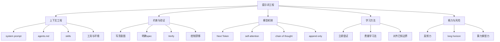

> 来源：[B站视频](https://www.bilibili.com/video/BV1CQt365EzW) · UP主：绿导师原谅你了 · 时长：1:38:26
>
> 本笔记由本地 GPU 转写（large-v3-turbo）和 AI 整理生成。专有名词、数字和事实性断言请结合原视频核对。

## 一句话总结

本讲把“提示词工程”重新定义为“上下文工程”：提示词不只是对话框里打的字，而是 agent 能看到的整个线性上下文（system prompt、agents.md、skills、工具定义、环境注入等）；讲述者围绕“如何把意图、约束和验证信号写清楚”展开，并用注意力机制、思维链、可验证性等原理解释模型为何遵循或漂移，最后落到学习方法与 AI 时代的精力分配问题。

## 视频试图回答的问题

- 提示词到底是什么？为什么“优化提示词”实际是“上下文工程”？[00:00](https://www.bilibili.com/video/BV1CQt365EzW?t=0) [03:18](https://www.bilibili.com/video/BV1CQt365EzW?t=198)
- agent 的上下文里究竟有什么（system prompt、agents.md、skills、工具定义、环境变量）？[01:40](https://www.bilibili.com/video/BV1CQt365EzW?t=100) [07:57](https://www.bilibili.com/video/BV1CQt365EzW?t=477) [08:05](https://www.bilibili.com/video/BV1CQt365EzW?t=485) [08:49](https://www.bilibili.com/video/BV1CQt365EzW?t=529) [08:55](https://www.bilibili.com/video/BV1CQt365EzW?t=535)
- 怎样写出好的提示词/好的模型上下文，让模型不漂移、可验证地完成任务？[18:56](https://www.bilibili.com/video/BV1CQt365EzW?t=1136) [20:28](https://www.bilibili.com/video/BV1CQt365EzW?t=1228) [21:27](https://www.bilibili.com/video/BV1CQt365EzW?t=1287)
- 模型为什么能遵循指令？注意力机制与思维链在其中起什么作用？[33:17](https://www.bilibili.com/video/BV1CQt365EzW?t=1997) [47:37](https://www.bilibili.com/video/BV1CQt365EzW?t=2857) [49:53](https://www.bilibili.com/video/BV1CQt365EzW?t=2993)
- 如何抵抗上下文被“逻辑自洽的材料”污染，让 AI 与自己对齐？[59:59](https://www.bilibili.com/video/BV1CQt365EzW?t=3599) [1:00:11](https://www.bilibili.com/video/BV1CQt365EzW?t=3611) [1:01:04](https://www.bilibili.com/video/BV1CQt365EzW?t=3664)
- 在 AI 时代，人的精力应该放在哪里？long horizon 任务与“算力换智力”意味着什么？[1:29:50](https://www.bilibili.com/video/BV1CQt365EzW?t=5390) [1:34:09](https://www.bilibili.com/video/BV1CQt365EzW?t=5649) [1:37:26](https://www.bilibili.com/video/BV1CQt365EzW?t=5846)

## 老师/讲述者提出的核心观念

**1. 提示词是人与 AI 沟通的接口，但其真实范围是“整个上下文”。**
讲述者指出，提示词是自然语言与机器沟通的渠道 [00:00](https://www.bilibili.com/video/BV1CQt365EzW?t=0)；但 agent 看到的远不止对话框里的字——聊天前就有 system prompt，之后还会加载 agents.md、skills 等 [01:26](https://www.bilibili.com/video/BV1CQt365EzW?t=86) [01:40](https://www.bilibili.com/video/BV1CQt365EzW?t=100)，工具调用及其结果也出现在上下文中，构成线性上下文 [02:33](https://www.bilibili.com/video/BV1CQt365EzW?t=153)。因此“优化提示词”实际表达的是上下文工程 [03:18](https://www.bilibili.com/video/BV1CQt365EzW?t=198)。

**2. 所有事情都应该立即开始尝试。**
这是讲述者希望传达的最重要一件事 [04:47](https://www.bilibili.com/video/BV1CQt365EzW?t=287)。AI 是非常耐心的老师，可以任意程度追问 [05:02](https://www.bilibili.com/video/BV1CQt365EzW?t=302)；可以立即打开一个 agent 让它检查自己的上下文，agent 经常会给你惊喜 [05:40](https://www.bilibili.com/video/BV1CQt365EzW?t=340)。

**3. 指令给得越清楚，agent 完成得越好；模糊的 intent 会导致漂移。**
软件工程有 intent→spec→implementation 的流程，用模型做任务时是把大流程的一部分塞进上下文 [19:04](https://www.bilibili.com/video/BV1CQt365EzW?t=1144) [19:33](https://www.bilibili.com/video/BV1CQt365EzW?t=1173)。给模糊的 intent，模型很容易认为完成了、可能发生漂移 [20:28](https://www.bilibili.com/video/BV1CQt365EzW?t=1228)；给完整系统设计和 spec，模型遵循 spec 就更确定、更可验证 [20:51](https://www.bilibili.com/video/BV1CQt365EzW?t=1251)。要控制漂移，应直接点明约束 [22:35](https://www.bilibili.com/video/BV1CQt365EzW?t=1355)。讲述者概括为“写清楚你要什么、用什么实现、怎样才算正确”的 raw prompt [24:25](https://www.bilibili.com/video/BV1CQt365EzW?t=1465)，本课最重要的是怎么去约束它，用最小的方向性引导让它改对 [24:40](https://www.bilibili.com/video/BV1CQt365EzW?t=1480)。

**4. 任务可验证且明确时，agent 会不知疲倦地做下去。**
这是讲述者强调的“模型上下文最重要的原则” [21:27](https://www.bilibili.com/video/BV1CQt365EzW?t=1287)。论据包括：OpenAI 的 agent 在 CTF 竞赛中通过非常长的多轮对话攻破 hugging face 漏洞，上千个 agent 完成不可能完成的任务 [21:53](https://www.bilibili.com/video/BV1CQt365EzW?t=1313)；一旦任务可验证且明确，agent 会不知疲倦地做下去 [22:22](https://www.bilibili.com/video/BV1CQt365EzW?t=1342)。

**5. 写 Prompt 最重要的是 Verify。**
讲述者明确说“写 Prompt 最重要的是那个 Verify” [44:41](https://www.bilibili.com/video/BV1CQt365EzW?t=2681)：如果能给模型非常明确的 Verify，加上足够强的模型，不管编程任务还是教学任务都能做好 [44:47](https://www.bilibili.com/video/BV1CQt365EzW?t=2687)。教学任务最难，因为很难 Verify [45:07](https://www.bilibili.com/video/BV1CQt365EzW?t=2707)；讲述者自己的数字切片第二个一直没做好，因为很难写一个“好”的标准，且“好”是多方面的 [45:12](https://www.bilibili.com/video/BV1CQt365EzW?t=2712)。在有 verifier 的事情上，完全可以认为 AI 已经超越了大部分人做这件事的极限 [47:02](https://www.bilibili.com/video/BV1CQt365EzW?t=2822)。

**6. 模型遵循指令的机制是注意力 + 思维链。**
模型是概率分布，根据当前上下文 predict next token [33:27](https://www.bilibili.com/video/BV1CQt365EzW?t=2007)；每次输出一个 token 是非常有限的计算 [33:38](https://www.bilibili.com/video/BV1CQt365EzW?t=2018)。chain of thought 把上下文当作 paper and pencil [36:16](https://www.bilibili.com/video/BV1CQt365EzW?t=2176)，但这个纸笔只能往后写、不能擦（append only）[36:33](https://www.bilibili.com/video/BV1CQt365EzW?t=2193)。self-attention 让模型在输出每个 token 时注意到过去某些 token [48:00](https://www.bilibili.com/video/BV1CQt365EzW?t=2880)；思维链一直向前走，会不断在不同时刻注意到不同部分，eventually 满足上下文中所有指令 [49:53](https://www.bilibili.com/video/BV1CQt365EzW?t=2993)；停下来喘气时能看到当前输出和过去要求的冲突，然后纠错 [50:07](https://www.bilibili.com/video/BV1CQt365EzW?t=3007)。指令越多，给模型的压力也越大，上下文是一种会抢夺注意力的资源 [50:45](https://www.bilibili.com/video/BV1CQt365EzW?t=3045)。

**7. 早期“你是一个专家”式长提示词是在 hack 注意力；GPT5 时代起更应写明确的 verifier。**
ChatGPT 3.5 遵循指令能力太差，所以网上有很多 Prompt Engineering guide 写很长的提示词，某种程度上是在 hack 模型的 self-attention [50:57](https://www.bilibili.com/video/BV1CQt365EzW?t=3057)；从 GPT5 时代开始，chain of thought 训出来了，不需要那样奇怪的提示词，只需把明确的 verifier 写在上下文里 [51:29](https://www.bilibili.com/video/BV1CQt365EzW?t=3089)。

**8. 读论文/材料时要抵抗上下文污染，先与 AI 对齐“人类已知边界”。**
论文逻辑自洽、反复修改过，注意力污染极强，模型容易接受因为看起来正确 [56:33](https://www.bilibili.com/video/BV1CQt365EzW?t=3393)；所有对论文的总结都是作者的观点 [57:15](https://www.bilibili.com/video/BV1CQt365EzW?t=3435)。模型会有“墙头草”现象 [58:20](https://www.bilibili.com/video/BV1CQt365EzW?t=3500)。讲述者的经验是：希望 AI 和我对齐，站在我的立场理解 paper [1:00:11](https://www.bilibili.com/video/BV1CQt365EzW?t=3611)；提示方式是“站在人类已知的知识边界看这个问题，先问人类历史上相关的已解决的东西是什么、解决到什么程度，然后这个工作试图解决哪些不一样的增量问题” [1:01:04](https://www.bilibili.com/video/BV1CQt365EzW?t=3664)，这是非常好的 grounding [1:01:53](https://www.bilibili.com/video/BV1CQt365EzW?t=3713)。对学生来说需要对齐的是 AI 和你，比如计算机系统基础学到什么程度、编程水平是什么 [1:02:04](https://www.bilibili.com/video/BV1CQt365EzW?t=3724)；要告诉 AI 你学到什么程度，让它基于已有知识把内容全部 rephrase [1:02:25](https://www.bilibili.com/video/BV1CQt365EzW?t=3745)。

**9. 精力应放在“不知道的东西想把它弄知道”上，避免假努力。**
学生几乎百分之百的时间应花在“不知道的东西想把它弄知道”上 [1:30:47](https://www.bilibili.com/video/BV1CQt365EzW?t=5447)；知道该怎么干、AI 能把它干好的事情，就放手让 AI 干 [1:30:59](https://www.bilibili.com/video/BV1CQt365EzW?t=5459)。preAI 时代就说过不要假努力，AI 时代假努力与真努力的效果差距会拉得更大 [1:31:07](https://www.bilibili.com/video/BV1CQt365EzW?t=5467) [1:31:17](https://www.bilibili.com/video/BV1CQt365EzW?t=5477)。

**10. long horizon 任务需要系统性调研，可用“算力换智力”。**
真正 long horizon、非常难的任务不是解决一个问题，而是在不确定性中探索 [1:32:14](https://www.bilibili.com/video/BV1CQt365EzW?t=5534)；模型被训练成完成任务才有奖励，所以会给一个有限的方案 [1:32:52](https://www.bilibili.com/video/BV1CQt365EzW?t=5572)，因为搜索困难、验证容易，模型势必只能做有限的搜索 [1:33:40](https://www.bilibili.com/video/BV1CQt365EzW?t=5620)。可以用算力换智力的循环 [1:34:09](https://www.bilibili.com/video/BV1CQt365EzW?t=5649)：把空间分割成很多 determined 的部分，每个部分变成有 verifier 的更明确的东西 [1:36:31](https://www.bilibili.com/video/BV1CQt365EzW?t=5791)。讲述者同时提出警示：若真正有价值的问题可以用算力换智力，可能出现“墙内是超人、墙外是动物世界”的残酷现实 [1:37:42](https://www.bilibili.com/video/BV1CQt365EzW?t=5862) [1:38:10](https://www.bilibili.com/video/BV1CQt365EzW?t=5890)，需要思考怎样防止这件事情到来 [1:38:14](https://www.bilibili.com/video/BV1CQt365EzW?t=5894)。

## 概念与术语

- **提示词**：你和 AI 沟通的渠道，自然语言的提示词，给机器一个指令 [00:00](https://www.bilibili.com/video/BV1CQt365EzW?t=0)。
- **system prompt**：agent 在和用户聊天之前就能看到的提示词，也叫提示词 [01:52](https://www.bilibili.com/video/BV1CQt365EzW?t=112)。
- **Agent Harness**：如 Codex 内建的系统提示词来源 [02:26](https://www.bilibili.com/video/BV1CQt365EzW?t=146)。
- **上下文工程**：优化提示词实际表达的是整个模型的上下文 [03:28](https://www.bilibili.com/video/BV1CQt365EzW?t=208)。
- **Next Token Prediction**：模型每次预测下一个 Token，可以是调用工具或输出字符 [03:35](https://www.bilibili.com/video/BV1CQt365EzW?t=215)。
- **agents.md**：用户目录下的 agent 配置文件，一层一层的，目录里面还可以再放 agents.md [07:32](https://www.bilibili.com/video/BV1CQt365EzW?t=452) [07:57](https://www.bilibili.com/video/BV1CQt365EzW?t=477)。
- **skills**：模型能够执行的功能，上下文里只看到 metadata（名字、简略描述），按需加载，匹配任务时才读取完整的 skill.md [08:07](https://www.bilibili.com/video/BV1CQt365EzW?t=487)。
- **YOLO 模式**：Pi 默认配置下所有事情都直接执行 [11:41](https://www.bilibili.com/video/BV1CQt365EzW?t=701)。
- **parser**：Codex 里处理 bash 命令的语法处理器 [17:07](https://www.bilibili.com/video/BV1CQt365EzW?t=1027)。
- **raw prompt**：写清楚要什么、用什么实现、怎样才算正确 [24:25](https://www.bilibili.com/video/BV1CQt365EzW?t=1465)。
- **有限状态机 / 图灵机**：有限状态机有一个有限的状态；图灵机有无限长纸带、有记忆可当草稿纸，二者唯一区别是纸带 [34:37](https://www.bilibili.com/video/BV1CQt365EzW?t=2077) [34:52](https://www.bilibili.com/video/BV1CQt365EzW?t=2092)。
- **chain of thought**：往后吐思维链的模型，把上下文当作 paper and pencil [36:16](https://www.bilibili.com/video/BV1CQt365EzW?t=2176)；append only，只能往后写、不能擦 [36:37](https://www.bilibili.com/video/BV1CQt365EzW?t=2197)。
- **幻觉**：模型无论如何一定要给一个东西，这么来的 [37:44](https://www.bilibili.com/video/BV1CQt365EzW?t=2264)。
- **test time scaling**：转写中与每次上课 session 类比 [38:37](https://www.bilibili.com/video/BV1CQt365EzW?t=2317)。
- **AI slop**：课件上带星的、AI 补充的东西 [40:50](https://www.bilibili.com/video/BV1CQt365EzW?t=2450)。
- **Verify**：明确的验证信号 [44:41](https://www.bilibili.com/video/BV1CQt365EzW?t=2681)。
- **self-attention**：注意力机制，一层一层叠起来的 transformer 注意力 [47:41](https://www.bilibili.com/video/BV1CQt365EzW?t=2861)。
- **grounding**：先让 AI 和自己站在平齐位置达成共识 [1:01:53](https://www.bilibili.com/video/BV1CQt365EzW?t=3713)。
- **long horizon**：带一点未知，从一个初始状态出发，specification 和 implementation 都不太清楚，最终目标是交付一个高质量的 implementation [1:15:42](https://www.bilibili.com/video/BV1CQt365EzW?t=4542)；也指不是解决一个问题，而是在不确定性当中探索的非常难的任务 [1:32:14](https://www.bilibili.com/video/BV1CQt365EzW?t=5534)。
- **NP 问题**：验证一个解比较容易、是 P 的，但找到满足条件的解很难 [1:33:12](https://www.bilibili.com/video/BV1CQt365EzW?t=5592)；如 HamiltonPath，判断路径很容易，找到满足条件的 Path 是 NP Complete [1:33:26](https://www.bilibili.com/video/BV1CQt365EzW?t=5606)。
- **算力换智力的循环**：把大空间分割成 determined 的部分，逐部分用 verifier 检查，以更多算力换取更大智力 [1:34:09](https://www.bilibili.com/video/BV1CQt365EzW?t=5649) [1:36:31](https://www.bilibili.com/video/BV1CQt365EzW?t=5791)。
- **Big World Hypothesis**：归于 Richard Sutton，说明我们学不到世界上所有的东西 [1:37:10](https://www.bilibili.com/video/BV1CQt365EzW?t=5830)。

## 关键例子和论据

- **Inline Assembly**：2023 年让 ChatGPT 讲 Inline Assembly，解释得出奇的好，故意做了一个地球人应该不会实现的 inline assembly，它做得相当好但不完美 [00:35](https://www.bilibili.com/video/BV1CQt365EzW?t=35)。
- **“喵”梗**：在最早的 prompt 上加“你每说一句话都要在后面加一个喵”，工作久了发现喵丢了，就知道上下文被截断或压缩，开始不能遵循指令了 [04:08](https://www.bilibili.com/video/BV1CQt365EzW?t=248)。
- **套取上下文**：让 agent 检查自己上下文里都有什么 [05:53](https://www.bilibili.com/video/BV1CQt365EzW?t=353)；演示机器在全局上下文里放了“用中文回答”和“结尾必须写一个 recap” [07:31](https://www.bilibili.com/video/BV1CQt365EzW?t=451)；和 DeepSeek Chat 聊天可以把每次注入的环境掏出来 [09:09](https://www.bilibili.com/video/BV1CQt365EzW?t=549)。
- **Codex 安全判定**：Codex 认为 ls -l 是安全命令直接执行 [12:55](https://www.bilibili.com/video/BV1CQt365EzW?t=775)；实际上这个命令可能不安全，因为环境里可能把 ls 重命名成别的命令 [13:16](https://www.bilibili.com/video/BV1CQt365EzW?t=796)；它确实有让大模型做风险评级，还有一层静态分流：沙箱内低风险命令直接执行，网络 allowlist 命中直接放行 [16:41](https://www.bilibili.com/video/BV1CQt365EzW?t=1001)；如果不是，会在 prompt 里 inject 一小段话让模型评级安全性，同样是 prompt engineering [17:18](https://www.bilibili.com/video/BV1CQt365EzW?t=1038)；可以让它把 prompt 改一改，观察行为变化，这就成为了一个证据 [17:52](https://www.bilibili.com/video/BV1CQt365EzW?t=1072)。
- **VSCode 配置**：很多同学从 PA1 做到 PA4，VSCode 里还有红线，有红线意味着没有解锁正确的配置 [15:44](https://www.bilibili.com/video/BV1CQt365EzW?t=944)；应该花时间 configure VSCode，加上 include path，配置好后可以得到 IDE 的所有功能 [16:14](https://www.bilibili.com/video/BV1CQt365EzW?t=974)。
- **赛车游戏**：Kimi K3 生成的赛车游戏物理、碰撞、逻辑制作、后视镜都很逼真 [22:43](https://www.bilibili.com/video/BV1CQt365EzW?t=1363)，但这依然可能不是你要的 CSGO，因为 AI 没办法补全你脑袋里模糊的约束 [23:20](https://www.bilibili.com/video/BV1CQt365EzW?t=1400)；如果要说复用真实地图和美术资产，它可能去 OpenStreetMap 下载开源地图，想在南大仙林校区开车是能做到的 [23:40](https://www.bilibili.com/video/BV1CQt365EzW?t=1420) [23:49](https://www.bilibili.com/video/BV1CQt365EzW?t=1429)。
- **个人主页对比**：一句话 prompt 生成的页面美术效果非常好、非常专业，类似 Pie.dev 或 Homebrew 的界面 [26:23](https://www.bilibili.com/video/BV1CQt365EzW?t=1583)，但 AI 味很重 [26:51](https://www.bilibili.com/video/BV1CQt365EzW?t=1611)；给“不要那么 AI 味”的 prompt，它可能也不知道怎么遵循 [27:14](https://www.bilibili.com/video/BV1CQt365EzW?t=1634)；老师的主页是真正的终端，可以有管道，字做了后处理呈现打字机的不完美效果，所以 AI 味没那么重，虽然一行代码也没写 [27:42](https://www.bilibili.com/video/BV1CQt365EzW?t=1662) [27:49](https://www.bilibili.com/video/BV1CQt365EzW?t=1669)。
- **藏头诗**：用中文写一个押韵的藏头诗，头是 nonsense，要求讲动物相关故事，要求“2026年9月1日”八个字分别按顺序出现在八句里 [38:53](https://www.bilibili.com/video/BV1CQt365EzW?t=2333)；模型先想韵脚，因为知道一把头写出来一定错，但可以先写一个出来，再用 next token prediction 判定对错，不对再改，试很久不行就从头换韵脚 [39:39](https://www.bilibili.com/video/BV1CQt365EzW?t=2379)。
- **同偏旁句子**：写一个 18 字的一句话，全部要求相同的偏旁或部首 [42:05](https://www.bilibili.com/video/BV1CQt365EzW?t=2525)；模型选三点水，生成“江湖游泳渡河波涛汹涌泪流满溢”等 [42:31](https://www.bilibili.com/video/BV1CQt365EzW?t=2551)；人类群体智慧给的是“玩玻璃球”“涂润滑油”之类 [43:13](https://www.bilibili.com/video/BV1CQt365EzW?t=2593)；讲述者指出在这个任务上人类还是有更强天赋，人类在做这件事上还是 a lot better [43:05](https://www.bilibili.com/video/BV1CQt365EzW?t=2585)。
- **读论文的污染**：演示读 paper.pdf 帮做总结 [56:18](https://www.bilibili.com/video/BV1CQt365EzW?t=3378)；论文逻辑自洽、反复修改过，注意力污染极强，A 所以 B 所以 C 所以 D 扣起来，模型容易接受因为看起来正确 [56:33](https://www.bilibili.com/video/BV1CQt365EzW?t=3393)；就算想纠正它，问“可能不能完全信任作者”，来回绕来绕去，可能揪到“实验做的还可以再增加一点”这种 AI 最喜欢的在不重要点上疯狂发力的地方 [58:34](https://www.bilibili.com/video/BV1CQt365EzW?t=3514)；如果真的用 GPT 去读，最好做一个交叉验证 [59:51](https://www.bilibili.com/video/BV1CQt365EzW?t=3591)。
- **审稿案例**：讲述者昨天 reject 了一篇 paper，说要做一件事情 A，A 分成 A1 和 A2，在 A2 上做了一个 A2 片，优化的是性能，A1 估算可能占百分之九十九，A2 占百分之一 [1:06:39](https://www.bilibili.com/video/BV1CQt365EzW?t=3999)；优化 A2 的 10%，这 10% 就像 noise 一样 [1:07:44](https://www.bilibili.com/video/BV1CQt365EzW?t=4064)；讲述者表示几乎不会因为实验不够好而 reject paper，reject 大部分是因为逻辑上断开了 [1:05:59](https://www.bilibili.com/video/BV1CQt365EzW?t=3959)。
- **AI 审稿被污染**：用 AI 审文章时，它会被上下文里面的故事给污染 [1:09:17](https://www.bilibili.com/video/BV1CQt365EzW?t=4157)；GPT5.6 给讲述者写的审稿，讲述者认为 GPT5.6 做的并不好 [1:09:40](https://www.bilibili.com/video/BV1CQt365EzW?t=4180)。
- **起名字**：用 Deepseek 起名字，别人也用 Deepseek 起名字，就会成为 AI 时代的子涵 [1:35:07](https://www.bilibili.com/video/BV1CQt365EzW?t=5707)；名字可以枚举，先选音、筛掉不好的音，再用 subagent 逐个检查字 [1:35:51](https://www.bilibili.com/video/BV1CQt365EzW?t=5751)，这样就实现了算力换智力 [1:36:13](https://www.bilibili.com/video/BV1CQt365EzW?t=5773)。
- **Linux 内核今昔对比**：讲述者大二大三接触 Linux 内核，光下载和搞清楚怎么编译就花了很长时间，是完全的劝退 [13:44](https://www.bilibili.com/video/BV1CQt365EzW?t=824)；今天不需要害怕任何一个软件系统的复杂性，因为可以直接问 [14:10](https://www.bilibili.com/video/BV1CQt365EzW?t=850)。

## 可学习的知识与方法

- **立即尝试法**：任何不懂的事直接打开 agent 追问，AI 是耐心的老师 [04:47](https://www.bilibili.com/video/BV1CQt365EzW?t=287) [05:02](https://www.bilibili.com/video/BV1CQt365EzW?t=302)。
- **上下文自检法**：让 agent 检查并列出自己上下文里有什么，观察 system prompt、环境注入、recap 要求等 [05:53](https://www.bilibili.com/video/BV1CQt365EzW?t=353) [07:31](https://www.bilibili.com/video/BV1CQt365EzW?t=451)。
- **“喵”探针法**：在 prompt 里加一个固定小尾巴（如每句加“喵”），尾巴丢失即说明上下文被截断或压缩 [04:08](https://www.bilibili.com/video/BV1CQt365EzW?t=248)。
- **raw prompt 三要素**：写清楚要什么、用什么实现、怎样才算正确 [24:25](https://www.bilibili.com/video/BV1CQt365EzW?t=1465)。
- **Verify 优先**：先设计明确的验证信号，再谈提示词措辞 [44:41](https://www.bilibili.com/video/BV1CQt365EzW?t=2681)。
- **最小方向性引导**：不写长篇“你是专家”，用最小引导让模型改对 [24:40](https://www.bilibili.com/video/BV1CQt365EzW?t=1480)。
- **grounding 对齐法**：先问“人类已知边界是什么、已解决到什么程度”，再问“这个工作的增量是什么” [1:01:04](https://www.bilibili.com/video/BV1CQt365EzW?t=3664) [1:01:53](https://www.bilibili.com/video/BV1CQt365EzW?t=3713)。
- **按水平 rephrase**：告诉 AI 自己的学习程度，让它基于已有知识重述内容 [1:02:25](https://www.bilibili.com/video/BV1CQt365EzW?t=3745)。
- **交叉验证**：读论文/审稿时用多个来源交叉核对，抵抗单一材料的注意力污染 [59:51](https://www.bilibili.com/video/BV1CQt365EzW?t=3591)。
- **算力换智力**：把大问题切成 determined 的小块，每块配 verifier，用 subagent 逐个检查 [1:34:09](https://www.bilibili.com/video/BV1CQt365EzW?t=5649) [1:35:51](https://www.bilibili.com/video/BV1CQt365EzW?t=5751) [1:36:31](https://www.bilibili.com/video/BV1CQt365EzW?t=5791)。
- **精力分配法**：只把时间花在“不知道→知道”上，已知且 AI 能干好的事放手 [1:30:47](https://www.bilibili.com/video/BV1CQt365EzW?t=5447) [1:30:59](https://www.bilibili.com/video/BV1CQt365EzW?t=5459)。

## 思维导图

## 值得继续思考的问题

- 讲述者说“所有事情都应该立即开始尝试” [04:47](https://www.bilibili.com/video/BV1CQt365EzW?t=287)，但在安全敏感场景（YOLO 模式、沙箱、危险命令确认）下，如何平衡“立即尝试”与风险控制？[11:29](https://www.bilibili.com/video/BV1CQt365EzW?t=689) [11:54](https://www.bilibili.com/video/BV1CQt365EzW?t=714) [12:01](https://www.bilibili.com/video/BV1CQt365EzW?t=721)
- 讲述者认为在有 verifier 的事情上 AI 已超越大部分人 [47:02](https://www.bilibili.com/video/BV1CQt365EzW?t=2822)，而教学这类“好”难以验证的任务仍难 [45:07](https://www.bilibili.com/video/BV1CQt365EzW?t=2707)；那么如何为“没有明确 verifier”的任务设计可验证的中间信号？
- “上下文是一种会抢夺注意力的资源” [50:45](https://www.bilibili.com/video/BV1CQt365EzW?t=3045)，指令越多压力越大；在实际工程中如何判断哪些约束必须写、哪些应交给模型自行规划？
- 讲述者提出“把自己蒸馏成一个 skill” [1:15:00](https://www.bilibili.com/video/BV1CQt365EzW?t=4500)，这需要哪些前提（知识边界、表达清晰度、可验证性）？
- 讲述者警示“墙内是超人、墙外是动物世界” [1:38:10](https://www.bilibili.com/video/BV1CQt365EzW?t=5890)，并说需要思考怎样防止这件事情到来 [1:38:14](https://www.bilibili.com/video/BV1CQt365EzW?t=5894)；个体学习者和教育者当下能做的具体动作是什么？
- 讲述者认为发表和评审体系很快就要崩溃，因为 AI Slop 大量涌入 community [1:08:48](https://www.bilibili.com/video/BV1CQt365EzW?t=4128) [1:09:01](https://www.bilibili.com/video/BV1CQt365EzW?t=4141)；交叉验证 [59:51](https://www.bilibili.com/video/BV1CQt365EzW?t=3591) 与“站在人类已知知识边界”的 grounding [1:01:04](https://www.bilibili.com/video/BV1CQt365EzW?t=3664) 能否成为评审流程的常规环节？

## 我的理解

> 待作者补充。
