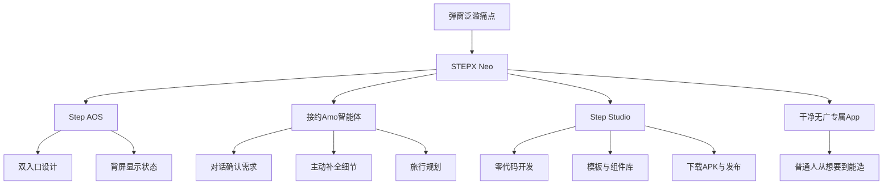

> 来源：[B站视频](https://www.bilibili.com/video/BV1Lk4w6iEPo) · UP主：Git源宝 · 时长：06:14
>
> 本笔记由本地 GPU 转写（large-v3-turbo）和 AI 整理生成。专有名词、数字和事实性断言请结合原视频核对。

## 一句话总结

视频以“手机弹窗泛滥”为切入点，演示了 STEPX Neo 手机上运行的大模型原生智能体“接约Amo”（转写用名）如何通过对话把用户想法落地成干净无广告的专属 App 和小游戏，并展示了它在旅行规划等日常事务中的使用方式，主张普通人可以“从我想要”变成“我能造”[05:11](https://www.bilibili.com/video/BV1Lk4w6iEPo?t=311)。

> 画面展示了一个以游戏化风格设计的习惯养成应用界面，包含用户等级、经验进度以及日常习惯打卡选项。

## 视频试图回答的问题

- 是否存在一个干净、无弹窗、还能自己开发应用的手机系统？[00:00](https://www.bilibili.com/video/BV1Lk4w6iEPo?t=0)
- 大模型原生智能体在手机上到底能做到什么程度？[00:28](https://www.bilibili.com/video/BV1Lk4w6iEPo?t=28)
- 普通人不懂代码，能否通过对话做出符合自己想法的 App？[05:00](https://www.bilibili.com/video/BV1Lk4w6iEPo?t=300)
- 这种“自己许愿自己造”的方式，相比传统 App 开发流程改变了什么？[02:43](https://www.bilibili.com/video/BV1Lk4w6iEPo?t=163)

> 画面通过左右两部手机对比，展示了添加吃药提醒功能在“直接生成”和“套用主题”两种方式下的界面差异，突出主题美化后的视觉效果。

## 老师/讲述者提出的核心观念

1. **开发门槛的判断：App 开发不再是专业人士专属。** 讲述者明确说“以前我们总觉得做 APP 是离普通人很远的事情，那是专业人士的领域”，而现在 Step Studio 主打“零代码零学习成本”，让普通人“从我想要”变成“我能造”[05:00](https://www.bilibili.com/video/BV1Lk4w6iEPo?t=300)[05:11](https://www.bilibili.com/video/BV1Lk4w6iEPo?t=311)。这是视频的核心论点。

2. **对话即开发，且能超出预期。** 讲述者只提出四个习惯打卡的需求，智能体不仅全部实现，还主动补充了自定义添加习惯、打卡撤回与重置、卡片备注提醒等未提及的细节[01:10](https://www.bilibili.com/video/BV1Lk4w6iEPo?t=70)[01:15](https://www.bilibili.com/video/BV1Lk4w6iEPo?t=75)。讲述者据此判断：智能体不只是执行指令，还会补全需求。

3. **迭代靠“说”，不靠“改代码”。** 界面“太单一”“不够融入”“有点割裂”等问题，通过几轮对话调整就达到超出预期的效果[00:54](https://www.bilibili.com/video/BV1Lk4w6iEPo?t=54)[01:02](https://www.bilibili.com/video/BV1Lk4w6iEPo?t=62)。这体现的是用自然语言描述感受来驱动修改的方法。

4. **干净无广是这套方案的价值主张。** 讲述者把成品描述为“完全按照我们新一座的、干净无广的专书APP”[02:57](https://www.bilibili.com/video/BV1Lk4w6iEPo?t=177)，与开头弹窗泛滥的痛点形成呼应。

5. **对平台规则的判断：先立规矩才能走宽。** 面对“免费帮你开发应用套数据”的质疑，讲述者给出发布不等于上架应用市场、测试数据不用于商业使用、提供上链数字证书等回应，并总结“先把规矩立住，录台能越走越宽，这样我才用着不烧心”[02:26](https://www.bilibili.com/video/BV1Lk4w6iEPo?t=146)[02:38](https://www.bilibili.com/video/BV1Lk4w6iEPo?t=158)。

6. **AI 与手机的关系被重新定义。** 讲述者认为 STEP X 让 AI 不再是“手机里多加一个 APP 那么单一”，而是“从硬件、操作系统、大模型一体的全方位智能体体验终端”[05:28](https://www.bilibili.com/video/BV1Lk4w6iEPo?t=328)。

7. **交互习惯会被改变。** 讲述者观察到“用着用着，我们会开始习惯有些小事情可以先问问 JRAMO 能不能帮上忙”，并称这是与平常手机“完全不一样的体验”[04:51](https://www.bilibili.com/video/BV1Lk4w6iEPo?t=291)。

> 画面展示网页端开发界面与手机端扫码安装的提示信息，强调通过网页端开发后下载的安装包体积较小。

## 概念与术语

- **接约Amo / JRAMO**：转写中出现的智能体名称，视频称其为“Step AOS 上运行的大模型原生智能体”，靠 STEPX Neo 感知环境并落地用户想法[00:20](https://www.bilibili.com/video/BV1Lk4w6iEPo?t=20)。名称转写不一致，见“待核实”。
- **Step AOS**：手机操作系统，视频称其 UI 简约、支持桌面策划找 APP、无极调节小窗，并做了“传统界面与接约Amo 的双入口”设计[04:26](https://www.bilibili.com/video/BV1Lk4w6iEPo?t=266)[04:36](https://www.bilibili.com/video/BV1Lk4w6iEPo?t=276)。
- **Step Studio**：零代码开发工具，支持云端一站式开发、网页端测试修改、下载 APK、发布分享[02:05](https://www.bilibili.com/video/BV1Lk4w6iEPo?t=125)[05:04](https://www.bilibili.com/video/BV1Lk4w6iEPo?t=304)。
- **双入口设计**：用户可自由选择手动操作或让 Agent 帮忙[04:36](https://www.bilibili.com/video/BV1Lk4w6iEPo?t=276)。
- **mini LED 点阵背屏**：手机背屏，可实时显示 Agent 在想什么、忙到哪一步，且支持自定义[03:45](https://www.bilibili.com/video/BV1Lk4w6iEPo?t=225)[03:53](https://www.bilibili.com/video/BV1Lk4w6iEPo?t=233)。
- **OTA 迭代升级**：来自视频简介，指持续升级与自我进化（正文转写未展开）。
- **APK**：安卓安装包，视频称成品“就几兆的大小”[02:13](https://www.bilibili.com/video/BV1Lk4w6iEPo?t=133)。
- **YPAY**：视频提到接入支付宝的 YPAY，为作品增加收款功能[02:32](https://www.bilibili.com/video/BV1Lk4w6iEPo?t=152)。

> 画面展示了手机AI助手根据用户需求快速筛选并推荐成都酒店的过程，列表中呈现了酒店名称、评分、地址和价格信息，便于用户直接核对与预订。

## 关键例子和论据

**例1：打卡养成类 App（核心演示）**
- 需求：生活不规律，想做模拟养成类 App 督促打卡（喝水、早睡、洗衣服、洗澡），要求有趣不死板，以自己为主角[00:31](https://www.bilibili.com/video/BV1Lk4w6iEPo?t=31)[00:45](https://www.bilibili.com/video/BV1Lk4w6iEPo?t=45)。
- 智能体反问确认：打卡记录怎么保存（选 A 本地保存）、想要什么配色氛围（游戏风格）[00:47](https://www.bilibili.com/video/BV1Lk4w6iEPo?t=47)[00:53](https://www.bilibili.com/video/BV1Lk4w6iEPo?t=53)。
- 迭代过程：操作界面太单一 → 把等级转换成虚拟人物；地图卡片和人物剪辑卡融合成意识卡；仍觉割裂 → 再调整[00:54](https://www.bilibili.com/video/BV1Lk4w6iEPo?t=54)[01:02](https://www.bilibili.com/video/BV1Lk4w6iEPo?t=62)。
- 结果：四轮调整后超出预期，界面更精致，卡片元素更多；智能体主动加了自定义习惯、打卡撤回重置、卡片备注提醒[01:04](https://www.bilibili.com/video/BV1Lk4w6iEPo?t=64)[01:15](https://www.bilibili.com/video/BV1Lk4w6iEPo?t=75)。

**例2：降低描述门槛的辅助手段**
- 没有头绪、不会描述效果时，可用预设主题、组件库、现成模板[01:27](https://www.bilibili.com/video/BV1Lk4w6iEPo?t=87)。
- 对比论据：同样做长辈吃药提醒，“直接生成”与“选择主题再生成”，讲述者判断套了主题的右边更好看[01:32](https://www.bilibili.com/video/BV1Lk4w6iEPo?t=92)[01:37](https://www.bilibili.com/video/BV1Lk4w6iEPo?t=97)。
- 组件库可随意加：在打卡 App 里塞天气组件，数据与系统自带一致[01:41](https://www.bilibili.com/video/BV1Lk4w6iEPo?t=101)。

**例3：小游戏**
- 火柴人大战直接套模板一键生成，不用下载，扫码即可在手机上玩，方便且不占空间[01:50](https://www.bilibili.com/video/BV1Lk4w6iEPo?t=110)。

**例4：开发与发布流程**
- 全程在网页端测试修改，满意后下载 APK 安装到手机[02:05](https://www.bilibili.com/video/BV1Lk4w6iEPo?t=125)。
- 可在 Step Studio 发布，分享链接给朋友，能安装 APK 的手机都能用[02:15](https://www.bilibili.com/video/BV1Lk4w6iEPo?t=135)。

**例5：旅行规划（日常事务演示）**
- 需求：去成都玩，时间不要安排太紧[03:13](https://www.bilibili.com/video/BV1Lk4w6iEPo?t=193)。
- 智能体先确认关键信息：玩几天、以什么为主、住宿和交通怎么选[03:17](https://www.bilibili.com/video/BV1Lk4w6iEPo?t=197)。
- 输出完整行程，机票酒店直接选好，用户只需核对支付，返程也可一起安排[03:24](https://www.bilibili.com/video/BV1Lk4w6iEPo?t=204)[03:30](https://www.bilibili.com/video/BV1Lk4w6iEPo?t=210)。
- 对比论据：以前做攻略要在好几个 App 间来回切换、逐个参考对比再付钱[03:32](https://www.bilibili.com/video/BV1Lk4w6iEPo?t=212)。

**例6：外观与系统体验**
- 复古未来美学、透明探索设计，背面电路板与模块化结构外露，芯片代码“宇宙终极答案42”等科技元素可见[04:06](https://www.bilibili.com/video/BV1Lk4w6iEPo?t=246)[04:16](https://www.bilibili.com/video/BV1Lk4w6iEPo?t=256)。
- 系统流畅，双入口设计，侧边有 AI 实体按键，支持复一屏、长按导航条、语音唤醒与智能体互动[04:43](https://www.bilibili.com/video/BV1Lk4w6iEPo?t=283)。

**例7：购买权益（视频陈述）**
- 购买 STEP X 附赠连续 12 个月、每月百亿 Token；前一万名送“新陈传票”，未来五年内可 0 元换取任意一款 STEPX 新款中断[05:39](https://www.bilibili.com/video/BV1Lk4w6iEPo?t=339)[05:48](https://www.bilibili.com/video/BV1Lk4w6iEPo?t=348)。

## 可学习的知识与方法

- **用“对话迭代”代替“改代码”**：先用自然语言描述需求，再针对界面“太单一”“不够融入”“有点割裂”等感受逐轮反馈，让智能体调整[00:54](https://www.bilibili.com/video/BV1Lk4w6iEPo?t=54)[01:02](https://www.bilibili.com/video/BV1Lk4w6iEPo?t=62)。
- **需求不清时先让智能体反问**：打卡 App 案例中，智能体主动确认数据保存方式与配色氛围，再动手生成[00:47](https://www.bilibili.com/video/BV1Lk4w6iEPo?t=47)[00:53](https://www.bilibili.com/video/BV1Lk4w6iEPo?t=53)。
- **不会描述效果时借助预设**：用预设主题、组件库、现成模板降低表达门槛，并可通过对比“直接生成”与“套主题生成”判断效果[01:27](https://www.bilibili.com/video/BV1Lk4w6iEPo?t=87)[01:37](https://www.bilibili.com/video/BV1Lk4w6iEPo?t=97)。
- **用组件库扩展功能**：在已有 App 中加入天气等组件，数据与系统自带一致[01:41](https://www.bilibili.com/video/BV1Lk4w6iEPo?t=101)。
- **开发流程可拆为：网页端测试修改 → 下载 APK → 发布分享链接**[02:05](https://www.bilibili.com/video/BV1Lk4w6iEPo?t=125)[02:15](https://www.bilibili.com/video/BV1Lk4w6iEPo?t=135)。
- **日常事务可先问智能体**：旅行规划中先确认天数、主题、住宿交通，再输出含机票酒店的完整行程，用户只做核对支付[03:17](https://www.bilibili.com/video/BV1Lk4w6iEPo?t=197)[03:30](https://www.bilibili.com/video/BV1Lk4w6iEPo?t=210)。

## 思维导图

## 值得继续思考的问题

- 视频称智能体能“主动加上没想到的细节”[01:12](https://www.bilibili.com/video/BV1Lk4w6iEPo?t=72)，这种补全在多大程度上可靠？用户如何判断哪些是需求、哪些是自作主张？
- “干净无广”是成品 App 的属性，还是平台分发的承诺？视频未说明发布后的 App 是否可能被第三方加入广告。
- 发布不等于上架应用市场[02:26](https://www.bilibili.com/video/BV1Lk4w6iEPo?t=146)，那么分享链接给朋友使用的边界在哪里？视频只给了平台方的说法，未展示实际约束机制。
- 旅行规划中“机票酒店都直接帮我选好了，只需核对支付”[03:26](https://www.bilibili.com/video/BV1Lk4w6iEPo?t=206)，选好的依据是什么？用户对选择结果的可控性如何？
- 每月百亿 Token 的赠送[05:41](https://www.bilibili.com/video/BV1Lk4w6iEPo?t=341)用完后，持续使用智能体的成本如何？视频未提及。
- 背屏与开发应用联动的接口“后续计划开放”[03:57](https://www.bilibili.com/video/BV1Lk4w6iEPo?t=237)，目前只是计划，实际能力待观察。

## 待核实

- **智能体名称**：转写中先后出现“接约Amo”“JRAMO”“节约A某”“JRAMA”等写法，视频信息与简介中未给出统一中文名，需以官方名称为准。
- **“Step AOS 1.0”**：转写为“STEP AOS 1.0”[05:21](https://www.bilibili.com/video/BV1Lk4w6iEPo?t=321)，版本号是否准确待核实。
- **“每月百亿 Token”与“前一万名”“五年内 0 元换新”**：均为视频中的陈述[05:39](https://www.bilibili.com/video/BV1Lk4w6iEPo?t=339)[05:48](https://www.bilibili.com/video/BV1Lk4w6iEPo?t=348)，未见独立来源，属待核实信息。
- **“上链的数字证书”“接入支付宝的 YPAY”**：视频提及[02:30](https://www.bilibili.com/video/BV1Lk4w6iEPo?t=150)[02:32](https://www.bilibili.com/video/BV1Lk4w6iEPo?t=152)，具体实现与适用范围未展示。
- **“数据跟系统自带的一模一样”**（天气组件）[01:44](https://www.bilibili.com/video/BV1Lk4w6iEPo?t=104)：为讲述者主观对比，未给出验证方法。
- **“就几兆的大小”**[02:13](https://www.bilibili.com/video/BV1Lk4w6iEPo?t=133)：为视频陈述，未展示实际安装包大小。
- **“测试的数据也不会用在商业使用”**[02:28](https://www.bilibili.com/video/BV1Lk4w6iEPo?t=148)：平台方说法，需查阅实际条款确认。
- **“芯片代码宇宙终极答案42”**[04:16](https://www.bilibili.com/video/BV1Lk4w6iEPo?t=256)：属外观设计元素描述，转写可能有误，需以实物为准。

## 我的理解

> 待作者补充。
