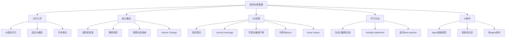

> 来源：[B站视频](https://www.bilibili.com/video/BV1kybV6DE47) · UP主：绿导师原谅你了 · 时长：1:40:14
>
> 本笔记由本地 GPU 转写（large-v3-turbo）和 AI 整理生成。专有名词、数字和事实性断言请结合原视频核对。

## 一句话总结

这堂课以 Git 为切口讲软件工程：软件项目是一个目录及其全部相关文件的集合，Git 用快照和 Atomic Change 管理项目历史，而真正要学的是水面下的 best practice——及时提交、写清 commit message、不提交编译产物、保持线性历史等，这些规范背后是“人类无法处理一团混沌”这一根本约束。

> 该幻灯片定义了软件工程项目的基本构成：包含需求、规格和实现文件的目录，通过构建流程生成可交付的应用或服务。

## 视频试图回答的问题

- 在 AI 已经能写代码、甚至代码越来越难被人类 review 的时代，为什么还要学软件工程知识？[06:46](https://www.bilibili.com/video/BV1kybV6DE47?t=406) [08:32](https://www.bilibili.com/video/BV1kybV6DE47?t=512)
- 软件和软件工程项目到底是什么？[12:26](https://www.bilibili.com/video/BV1kybV6DE47?t=746) [13:18](https://www.bilibili.com/video/BV1kybV6DE47?t=798)
- 为什么版本管理要用 Git，Git 的设计 first principle 是什么？[15:10](https://www.bilibili.com/video/BV1kybV6DE47?t=910) [32:07](https://www.bilibili.com/video/BV1kybV6DE47?t=1927)
- Git 有哪些 best practice，它们为什么存在？[43:19](https://www.bilibili.com/video/BV1kybV6DE47?t=2599) [43:35](https://www.bilibili.com/video/BV1kybV6DE47?t=2615)
- 如何借助 AI agent 学习和执行这些工程规范？[35:17](https://www.bilibili.com/video/BV1kybV6DE47?t=2117) [50:29](https://www.bilibili.com/video/BV1kybV6DE47?t=3029)

> 该幻灯片强调在学习变容易的背景下学习意识的重要性，指出大量他人的项目可作为学习素材，并建议将浏览转化为具体问题以提升学习效果。

## 老师/讲述者提出的核心观念

**1. AI 是执行力，人的品位和概念理解仍然重要。** 讲者认为有经验的软件工程师有较好的品位，可以指导 AI 做出更好的东西，AI 更多时候只是完成任务，还没有学会这种品位 [00:59](https://www.bilibili.com/video/BV1kybV6DE47?t=59)。AI 解锁的是执行力 [06:46](https://www.bilibili.com/video/BV1kybV6DE47?t=406)，但理解了正确的概念，可以帮助从别的地方借鉴知识来创造更好的东西 [08:54](https://www.bilibili.com/video/BV1kybV6DE47?t=534)。

**2. 学软件工程的理由是“今天答案肯定是要学”。** 讲者用汽车类比：一百多年前汽车刚发明时，每个司机都必须对汽车工作原理了解得非常清楚，今天开车不需要理解整个系统怎么工作 [07:13](https://www.bilibili.com/video/BV1kybV6DE47?t=433)；AI 比汽车更强，替代的不仅是人腿部向前走的能力，还替代人的智力 [08:18](https://www.bilibili.com/video/BV1kybV6DE47?t=498)。结论是今天要学，学了以后可以更好地解锁 AI 的创造力，但以后应该怎么学暂时不知道 [08:32](https://www.bilibili.com/video/BV1kybV6DE47?t=512)。

**3. 这门课讲的知识都不重要，重要的是学习意识。** 讲者明确说今天学习变容易了以后，这门课上讲的知识都不重要，重要的是学习意识 [17:04](https://www.bilibili.com/video/BV1kybV6DE47?t=1024)；要留意不同项目之间细微的区别，不停有信号进入时，就能判断出应该怎么用 Git [17:27](https://www.bilibili.com/video/BV1kybV6DE47?t=1047)。

**4. 学习方法：先自己做一遍，再比较。** 看到东西之前先把所有东西忽略掉，想如果自己来解决会怎么做，然后立即比较：自己更好就认为是 slop，对方更好就惊喜地问为什么 [22:18](https://www.bilibili.com/video/BV1kybV6DE47?t=1338)。读 research paper 时叫 virtually implement——先在脑袋里把问题自己做一遍 [23:00](https://www.bilibili.com/video/BV1kybV6DE47?t=1380)；如果方法和作者一致，说明已完全掌握；不一致时，要么教科书方案更好更精巧简洁，变成知识的一部分，要么自己的方法更好，可能一万次才有一次 [23:37](https://www.bilibili.com/video/BV1kybV6DE47?t=1417)。

**5. 从需求反推设计，是数学式的推理。** 从“想回到上一个版本”的需求就能自己发明类似 Git 的东西 [30:01](https://www.bilibili.com/video/BV1kybV6DE47?t=1801)；建议用这种方式从已有经验推出下一个概念，这就是数学的推理 [34:07](https://www.bilibili.com/video/BV1kybV6DE47?t=2047)。讲者还认为从 first principle 出发，一个大学生完全有可能设计出 Git 这样的东西 [1:07:09](https://www.bilibili.com/video/BV1kybV6DE47?t=4029)。

**6. best practice 是水面下的冰山，每一个都是血和泪的教训。** Git 里学了 git head、git push、git pull 就可以用了，但水面下的冰山是各种各样的 best practice [43:19](https://www.bilibili.com/video/BV1kybV6DE47?t=2599)，每一个 best practice 其实都是血和泪的教训 [43:35](https://www.bilibili.com/video/BV1kybV6DE47?t=2615)。

**7. 项目管理的本质是人类没有办法处理一团混沌。** 要把需求分解成可以理解、可以审计的小任务，一小步一小步来，出问题可以 bisect、可以 blame，协作时可以 blame，冲突也容易解决 [1:34:39](https://www.bilibili.com/video/BV1kybV6DE47?t=5679)。Git 本质上是一个软件，要把项目组织成用 Atomic Change 推进的快照，这是今天要记住的事情，所有的一切都从这句话推出来 [1:33:37](https://www.bilibili.com/video/BV1kybV6DE47?t=5617)。

**8. 工程细节的目的是保持一致性和规范。** 这些工程细节是为了工程师在面对更大项目时保持一致性和规范 [1:28:54](https://www.bilibili.com/video/BV1kybV6DE47?t=5334)；及时 Commit 是因为项目复杂后，修改越多出错可能越多，大 Commit 可能引入多个 Bug [1:30:02](https://www.bilibili.com/video/BV1kybV6DE47?t=5402)；每次 Commit 都很小、只做一个修改，bug 和修复可以配对，提供审计能力 [1:30:39](https://www.bilibili.com/video/BV1kybV6DE47?t=5439)。

**9. AI 时代更要对细节保持注意力。** 在 AI 时代更可以对细节保持注意力，比如 Git，看各种 Repo、读别人的东西甚至 AI 生成的东西，都有感知细节的方式 [24:16](https://www.bilibili.com/video/BV1kybV6DE47?t=1456)；学习要点第一多用一用，第二试图拥有更好的注意力 [29:01](https://www.bilibili.com/video/BV1kybV6DE47?t=1741)。

**10. 上课耽误学习是真实存在的。** 很多同学怨气很大觉得上课耽误学习，是因为现在课外的信息量和信息密度已经远远超过任何一个课堂可以做的事情 [21:17](https://www.bilibili.com/video/BV1kybV6DE47?t=1277)；传统教学方法没有教过大家怎么样把海量、信息密度巨大的东西用好 [21:49](https://www.bilibili.com/video/BV1kybV6DE47?t=1309)。

> 该幻灯片介绍了在Git出现之前，人们如何进行版本管理，包括通过复制目录、使用RCS等工具保存历史，以及使用CVS、SVN等集中式工具进行协作，并对比了Git的分布式特点。

## 概念与术语

- **软件（标准定义）**：代码文档等等一切和软件相关的东西的集合 [12:26](https://www.bilibili.com/video/BV1kybV6DE47?t=746)。
- **软件（讲者定义）**：人类世界的需求在信息世界里的一个投影 [13:18](https://www.bilibili.com/video/BV1kybV6DE47?t=798)。
- **软件工程项目**：创建一个目录，里面有一堆文件，共同构成一个可以交付的东西 [09:43](https://www.bilibili.com/video/BV1kybV6DE47?t=583) [10:26](https://www.bilibili.com/video/BV1kybV6DE47?t=626)。
- **Intended Spec Implementation 的空间**：转写中作为 AI 做得不好的原因被提及，指非常开放的意图-规格-实现空间 [01:30](https://www.bilibili.com/video/BV1kybV6DE47?t=90)；软件工程中存在 intended spec implementation 的 gap [02:56](https://www.bilibili.com/video/BV1kybV6DE47?t=176)。
- **Git**：除了能保存一个目录，还能保留比较和恢复历史的版本 [15:20](https://www.bilibili.com/video/BV1kybV6DE47?t=920)；是持久化的数据结构，持久化的是目录树 [1:03:41](https://www.bilibili.com/video/BV1kybV6DE47?t=3821)。
- **Git 的 first principle**：想要回到过去某个版本，一秒钟就回去 [32:07](https://www.bilibili.com/video/BV1kybV6DE47?t=1927)。
- **快照**：创建项目的快照，使你可以任意时间穿梭 [36:31](https://www.bilibili.com/video/BV1kybV6DE47?t=2191)；Git 提交应当是一个完整自洽的快照 [52:16](https://www.bilibili.com/video/BV1kybV6DE47?t=3136)。
- **commit message**：描述你改了什么，让人看到项目历史轨迹 [40:01](https://www.bilibili.com/video/BV1kybV6DE47?t=2401)。
- **Empty Commit**：无改动时产生一次提交，可触发 CI 或通知 [42:21](https://www.bilibili.com/video/BV1kybV6DE47?t=2541)；finalize 提交是为了 freeze 版本、没有改动的提交 [42:58](https://www.bilibili.com/video/BV1kybV6DE47?t=2578)。
- **SVN**：存储的是项目的变化，每次文件改一行就存一个 patch [31:40](https://www.bilibili.com/video/BV1kybV6DE47?t=1900)。
- **git blame**：告诉你每一行代码是在哪一次提交、哪一个地方改的 [52:38](https://www.bilibili.com/video/BV1kybV6DE47?t=3158)。
- **git bisect / 二分查找**：在很长的数组里找第一个一，前缀都是零、后缀都是一 [53:17](https://www.bilibili.com/video/BV1kybV6DE47?t=3197) [54:06](https://www.bilibili.com/video/BV1kybV6DE47?t=3246)。
- **hook**：钩子，可以 hook 程序的一个函数调用，在函数调用结束时干一件事；也可在 agent 里加入 hook [59:49](https://www.bilibili.com/video/BV1kybV6DE47?t=3589)。
- **分支**：就是一个文件，叫 refs，它就是指针，所谓分支就是指向这些东西的指针 [1:15:17](https://www.bilibili.com/video/BV1kybV6DE47?t=4517)；head 是指向指针的指针 [1:15:25](https://www.bilibili.com/video/BV1kybV6DE47?t=4525)。
- **Atomic Change**：把项目组织成用 Atomic Change 推进的快照 [1:33:43](https://www.bilibili.com/video/BV1kybV6DE47?t=5623)。
- **linear history**：强行要求整个 commit history 都是线性的 [1:35:48](https://www.bilibili.com/video/BV1kybV6DE47?t=5748)。
- **pure function**：把绝大部分接口设置成 functional 的，即 pure function [1:37:56](https://www.bilibili.com/video/BV1kybV6DE47?t=5876)。
- **conventional commits**：有标准的提交规范文档 [1:27:28](https://www.bilibili.com/video/BV1kybV6DE47?t=5248)；提交必须以某类型为前缀，包括 feature、fix bug，要一个冒号，一定要有一个空格 [1:27:35](https://www.bilibili.com/video/BV1kybV6DE47?t=5255)。
- **Commit often / Perfect later / Publish once**：Git 的 best practice [1:29:40](https://www.bilibili.com/video/BV1kybV6DE47?t=5380)。
- **AI Slop**：转写中用来形容 AI 生成的、巨长无比、带各种 unicode 字符框图的 ReadMe 的感觉 [18:57](https://www.bilibili.com/video/BV1kybV6DE47?t=1137)。

> 该幻灯片介绍了在掌握Git基础后，如何通过追问获取更深层的知识，并解释了Git最佳实践的来源及常见教训。

## 关键例子和论据

**关于 AI 能力与品位**
- 从 GP5 到 5.6 到 6，AI 写出来的代码越来越紧凑，人没有办法 review [01:53](https://www.bilibili.com/video/BV1kybV6DE47?t=113)；讲者曾经会 prompt AI 写出符合人类工程规范的代码，现在觉得再也不会看 AI 写的代码了，随它去，反正它能把代码弄对 [02:15](https://www.bilibili.com/video/BV1kybV6DE47?t=135)。
- OpenAI 对 AGI 的理解：首先 AI 得学会数学，因为数学是所有人类世界里面最难的语言，有全世界所有人都认同的推理系统 [02:38](https://www.bilibili.com/video/BV1kybV6DE47?t=158)；数学和软件工程里 intended spec implementation 的 gap 是反过来走的，数学有全球性共识 [02:56](https://www.bilibili.com/video/BV1kybV6DE47?t=176)。
- 空间感知的例子：给一个鲁班锁问按什么方向可以把第一块东西抽出来；给立方体投影问哪一块和它一样；给六面骰子问哪一个展开图对应 [04:20](https://www.bilibili.com/video/BV1kybV6DE47?t=260) [04:36](https://www.bilibili.com/video/BV1kybV6DE47?t=276)；光栅玩具从左边看和右边看是两个不同图案，有很长的搜索树，GP6 one shot 直接搞定 [05:28](https://www.bilibili.com/video/BV1kybV6DE47?t=328)。

**关于“目录即项目”**
- 进入真正的软件工程，开始做软件工程、开始 vibe coding，干的第一件事是先建一个目录 [09:05](https://www.bilibili.com/video/BV1kybV6DE47?t=545)。
- 著名笑话：GP6 太牛逼了，又做了多少个 killer 级的产品，它们是在 localhost 下的 5137 [10:49](https://www.bilibili.com/video/BV1kybV6DE47?t=649)；如果不知道 localhost 是本机，可以把 intent 和 specification 说得更清楚，说明东西要被全世界人看到 [11:10](https://www.bilibili.com/video/BV1kybV6DE47?t=670)。
- 讲者第一个 PhD student 的故事：2012 年入学进入南大，大一去机房，把代码保存到 U 盘上，大二 U 盘坏了，代码全部没有了，作业不见了 [13:46](https://www.bilibili.com/video/BV1kybV6DE47?t=826)；讲者上学时交作业的方式是打一个压缩包发邮件 [15:00](https://www.bilibili.com/video/BV1kybV6DE47?t=900)。

**关于 Git 的历史与设计**
- 1991 到 2002 年维护 Linux 用的是作业 V1 作业 V2 的方式，在邮件列表上发补丁：改了一个 A.C，往邮件列表一发，maintainer 看到后放到核心仓库里，再去 release 版本 [32:49](https://www.bilibili.com/video/BV1kybV6DE47?t=1969) [33:03](https://www.bilibili.com/video/BV1kybV6DE47?t=1983)；后面还用过 Bitkeeper 等工具 [33:21](https://www.bilibili.com/video/BV1kybV6DE47?t=2001)；直到 Linus 受不了，认为应该要一个绝对简单、好用、概念正确的版本控制工具，2005 年做了 Git [33:24](https://www.bilibili.com/video/BV1kybV6DE47?t=2004) [33:34](https://www.bilibili.com/video/BV1kybV6DE47?t=2014)。
- SVN 是非常高效的实现，但正是这个高效随着项目增长把大家拖入泥潭 [31:55](https://www.bilibili.com/video/BV1kybV6DE47?t=1915)；Git 的模型要干净得多，如果每次存的是 Delta，回到早期版本就得一个一个往回退，好像确实走错路了 [32:18](https://www.bilibili.com/video/BV1kybV6DE47?t=1938)。

**关于 commit 规范**
- 反例：“I did some cool stuff”作为 commit message，完全看不出做了什么 [39:37](https://www.bilibili.com/video/BV1kybV6DE47?t=2377)；如果一万个提交都是这样，commit message 就变成 slop 了 [40:36](https://www.bilibili.com/video/BV1kybV6DE47?t=2436)。
- 正确做法：用祈使句、现在时描述变更动机，例如 fix off by one in strlunch [46:19](https://www.bilibili.com/video/BV1kybV6DE47?t=2779)；常用约定 conventional commits 前缀也值得考虑 [46:27](https://www.bilibili.com/video/BV1kybV6DE47?t=2787)。
- 编译产物 hello 根本不应该进版本库，应该加进 gitignore [46:51](https://www.bilibili.com/video/BV1kybV6DE47?t=2811)；因为每个合作者环境不一样，build 出来的东西也不一样，编译出来的文件可能带日期、带 hash、带本机指纹，每次二进制文件可能都不一样，放进去下次就会产生冲突，二进制的冲突很难合并 [47:27](https://www.bilibili.com/video/BV1kybV6DE47?t=2847) [47:32](https://www.bilibili.com/video/BV1kybV6DE47?t=2852) [47:46](https://www.bilibili.com/video/BV1kybV6DE47?t=2866)。
- 提交编译不过的代码不符合规范：Git 提交应当是一个完整自洽的快照，提交编译不过的代码相当于让仓库处于坏状态 [52:16](https://www.bilibili.com/video/BV1kybV6DE47?t=3136)；每次提交的代码应该能够通过构建和测试，这是非常基础的要求 [54:49](https://www.bilibili.com/video/BV1kybV6DE47?t=3289)。

**关于冲突**
- 推免面试问什么是 Git，大家多多少少都能说两句，但问 git merge 发生冲突以后会观察到什么，大家答得不好 [25:17](https://www.bilibili.com/video/BV1kybV6DE47?t=1517) [25:51](https://www.bilibili.com/video/BV1kybV6DE47?t=1551)；如果愿意在冲突时停下来，会看到好多等号、好多箭头 [26:29](https://www.bilibili.com/video/BV1kybV6DE47?t=1589)；冲突以后不是立即被 resolve，责任到了开发者一手，开发者有义务把冲突解决掉，就需要能看到冲突 [26:48](https://www.bilibili.com/video/BV1kybV6DE47?t=1608)。
- 站在 Git 设计者角度：文件原来是 1111，一个人把第二行改成 2，另一个人改成 3，到底是 2 还是 3 [27:17](https://www.bilibili.com/video/BV1kybV6DE47?t=1637)；Git 的原则是发生一件事时最好在这个地方把所有要的信息全部放进来 [27:42](https://www.bilibili.com/video/BV1kybV6DE47?t=1662)。

**关于 agent 实践**
- 讲者让 agent 处理不符合规范的提交，它说：丢弃空提交和编译产物两端历史，新建分支，重写为两个有意义的单一值得提交 [48:46](https://www.bilibili.com/video/BV1kybV6DE47?t=2926)；它还贴心地发现历史没有 remote，不会有别人 [49:10](https://www.bilibili.com/video/BV1kybV6DE47?t=2950)。
- 讲者试一个不能编译的代码让它提交，它知道当前不建议直接提交，还给你修好了 [51:08](https://www.bilibili.com/video/BV1kybV6DE47?t=3068) [51:52](https://www.bilibili.com/video/BV1kybV6DE47?t=3112)。
- 讲者分享架构设计经验：先用单线程、用一个智力比较高的模型讨论，因为软件设计不好后面就是无穷的迭代 [1:36:47](https://www.bilibili.com/video/BV1kybV6DE47?t=5807)；把绝大部分接口设置成 pure function，所有全局互相影响的状态注册到一个全局的地方，核心共享状态只有十几行，几万个 token 就可以做一个 playground [1:37:51](https://www.bilibili.com/video/BV1kybV6DE47?t=5871) [1:38:26](https://www.bilibili.com/video/BV1kybV6DE47?t=5906) [1:38:49](https://www.bilibili.com/video/BV1kybV6DE47?t=5929)；架构设计完成后开三个 agent，agent.md 里有明确的协作规则，不要求调用视觉模型检查、不调用浏览器任务，而是在边上放一个及时刷新的浏览器，肉眼看着右边的东西不断变好 [1:38:55](https://www.bilibili.com/video/BV1kybV6DE47?t=5935) [1:39:17](https://www.bilibili.com/video/BV1kybV6DE47?t=5957) [1:39:31](https://www.bilibili.com/video/BV1kybV6DE47?t=5971)。

**关于文档与 UI 设计**
- 看到维护十几年的老项目，文档清新舒服，ReadMe 很短，三个链接就走过去了，就学会了文档应该这样写 [19:06](https://www.bilibili.com/video/BV1kybV6DE47?t=1146)。
- 香港找路：前面有三个口时，正前方一定有一个路牌告诉三个口是什么 [19:48](https://www.bilibili.com/video/BV1kybV6DE47?t=1188)；南京地铁站找出口需要环顾四周、移动比较远距离找地图 [20:09](https://www.bilibili.com/video/BV1kybV6DE47?t=1209)；lesson 是做 UI 设计要站在人的角度，用最少的方式把 ABC 全部呈现出来 [20:33](https://www.bilibili.com/video/BV1kybV6DE47?t=1233)。

> 画面展示了Conventional Commits提交信息规范的具体条款，以及使用该规范以自动化生成变更日志等优势。

## 可学习的知识与方法

- **先自答再对照**：接触任何方案前，先假设自己来解决会怎么做，再与现成方案比较，一致即掌握，不一致则分析谁更优 [22:18](https://www.bilibili.com/video/BV1kybV6DE47?t=1338) [23:37](https://www.bilibili.com/video/BV1kybV6DE47?t=1417)。
- **virtually implement**：读论文/读代码时在脑中先实现一遍问题 [23:00](https://www.bilibili.com/video/BV1kybV6DE47?t=1380)。
- **从需求反推设计**：从“想回到上一个版本”这类朴素需求出发，自己推导出 Git 式设计 [30:01](https://www.bilibili.com/video/BV1kybV6DE47?t=1801) [34:07](https://www.bilibili.com/video/BV1kybV6DE47?t=2047)。
- **追问 best practice 的由来**：把每条规范当作血泪教训去理解，而非死记 [43:19](https://www.bilibili.com/video/BV1kybV6DE47?t=2599) [43:35](https://www.bilibili.com/video/BV1kybV6DE47?t=2615)。
- **commit 写作**：祈使句、现在时、说清动机；可参考 conventional commits 前缀格式 [46:19](https://www.bilibili.com/video/BV1kybV6DE47?t=2779) [46:27](https://www.bilibili.com/video/BV1kybV6DE47?t=2787)。
- **仓库卫生**：编译产物、环境相关文件（如 .DS_Store）加入 gitignore，不提交二进制 [46:51](https://www.bilibili.com/video/BV1kybV6DE47?t=2811) [56:30](https://www.bilibili.com/video/BV1kybV6DE47?t=3390)。
- **提交纪律**：Commit often / Perfect later / Publish once；每次提交保持可构建、可测试、自洽 [1:29:40](https://www.bilibili.com/video/BV1kybV6DE47?t=5380) [52:16](https://www.bilibili.com/video/BV1kybV6DE47?t=3136) [54:49](https://www.bilibili.com/video/BV1kybV6DE47?t=3289)。
- **用 agent 做规范审计**：让 agent 检查并重写不合规历史、拦截不可编译提交 [48:46](https://www.bilibili.com/video/BV1kybV6DE47?t=2926) [51:08](https://www.bilibili.com/video/BV1kybV6DE47?t=3068)。
- **架构先行**：先单线程与高智力模型讨论架构，接口尽量 pure function，共享状态集中管理 [1:36:47](https://www.bilibili.com/video/BV1kybV6DE47?t=5807) [1:37:51](https://www.bilibili.com/video/BV1kybV6DE47?t=5871)。
- **多 agent 协作**：写好 agent.md 协作规则，配合实时刷新的浏览器肉眼验收 [1:38:55](https://www.bilibili.com/video/BV1kybV6DE47?t=5935) [1:39:17](https://www.bilibili.com/video/BV1kybV6DE47?t=5957)。
- **UI 设计视角**：站在使用者角度，用最少的方式把选项全部呈现出来 [20:33](https://www.bilibili.com/video/BV1kybV6DE47?t=1233)。

> 本画面探讨了当 AI Agent 代码生成速度提升 1000 倍时，传统 Git 版本控制面临的挑战，并提出设计一个 Agent VCS 的构想，通过类似数据库事务的机制来管理并发变更与验证。

## 思维导图

## 值得继续思考的问题

- 讲者说“今天答案肯定是要学，但以后应该怎么学暂时不知道” [08:32](https://www.bilibili.com/video/BV1kybV6DE47?t=512)——在 agent 能代劳具体命令的时代，学习者应该把精力放在哪些概念上？
- 讲者提出“你分不清是自己真的能干还是脱离了就干不了，但也许这不重要” [50:42](https://www.bilibili.com/video/BV1kybV6DE47?t=3042)——这个判断在什么条件下成立、在什么条件下不成立？
- 讲者说“如果 agent 快了 1000 倍，还怎么管理版本控制，可以下一节课再讨论” [1:40:00](https://www.bilibili.com/video/BV1kybV6DE47?t=6000)——版本控制的形态会如何变化？
- 讲者认为“在无限大能力的模型到来之前” linear history 都是好的 [1:36:16](https://www.bilibili.com/video/BV1kybV6DE47?t=5776)——这个前提如果改变，best practice 会不会整体失效？
- 讲者说“所有这些都被大模型杀死了” [58:36](https://www.bilibili.com/video/BV1kybV6DE47?t=3516)，指原本靠工具和导师检查的规范现在可由模型耐心检查——那么规范本身是变得更重要还是更不重要？

## 待核实

- 模型名称在转写中写法不一致：GP16、GP6、GPT6、GP5.6、GP5、GPC、GPE 等，具体版本号与名称需核实 [00:37](https://www.bilibili.com/video/BV1kybV6DE47?t=37) [01:01](https://www.bilibili.com/video/BV1kybV6DE47?t=61) [01:27](https://www.bilibili.com/video/BV1kybV6DE47?t=87) [02:05](https://www.bilibili.com/video/BV1kybV6DE47?t=125) [11:28](https://www.bilibili.com/video/BV1kybV6DE47?t=688)。
- “GP16 就真的发布了”疑似识别错误 [00:37](https://www.bilibili.com/video/BV1kybV6DE47?t=37)。
- “Intended Spat Inflamentation”疑似 Intended Spec Implementation 的识别错误 [01:30](https://www.bilibili.com/video/BV1kybV6DE47?t=90)。
- “视频链变得非常紧凑”疑似“思维链”的识别错误 [02:00](https://www.bilibili.com/video/BV1kybV6DE47?t=120)。
- “给它枪画学习”疑似“强化学习”的识别错误 [04:58](https://www.bilibili.com/video/BV1kybV6DE47?t=298)。
- “三级打印模型”疑似“3D 打印模型”的识别错误 [05:21](https://www.bilibili.com/video/BV1kybV6DE47?t=321)。
- “光山玩具”“光山尺”疑似“光栅玩具”“光栅尺”的识别错误 [05:30](https://www.bilibili.com/video/BV1kybV6DE47?t=330)。
- “聚身赛道”疑似“具身赛道”的识别错误 [05:56](https://www.bilibili.com/video/BV1kybV6DE47?t=356)。
- “一针一针”疑似“一帧一帧”的识别错误 [06:18](https://www.bilibili.com/video/BV1kybV6DE47?t=378)。
- “WiveCoding”疑似“vibe coding”的识别错误 [09:39](https://www.bilibili.com/video/BV1kybV6DE47?t=579)。
- “Giti”“DTub”疑似某代码托管平台的识别错误 [10:11](https://www.bilibili.com/video/BV1kybV6DE47?t=611) [18:47](https://www.bilibili.com/video/BV1kybV6DE47?t=1127)。
- “HGP localhost”疑似识别错误 [10:55](https://www.bilibili.com/video/BV1kybV6DE47?t=655)。
- “convenient science”疑似“computer science”的识别错误 [11:43](https://www.bilibili.com/video/BV1kybV6DE47?t=703)。
- “Vitch Studio”疑似“Visual Studio”的识别错误 [12:02](https://www.bilibili.com/video/BV1kybV6DE47?t=722)。
- “投诉complain”中英混写，需核实原意 [15:57](https://www.bilibili.com/video/BV1kybV6DE47?t=957)。
- “逻辑现金”疑似“逻辑陷阱”或“逻辑线”的识别错误 [23:14](https://www.bilibili.com/video/BV1kybV6DE47?t=1394)。
- “virtually implement”疑似某学习方法名称的识别错误 [23:24](https://www.bilibili.com/video/BV1kybV6DE47?t=1404)。
- “正款会也很搭”语义不明 [24:10](https://www.bilibili.com/video/BV1kybV6DE47?t=1450)。
- “git rebase是零off十”语义不明 [25:42](https://www.bilibili.com/video/BV1kybV6DE47?t=1542)。
- “NEO VM”需核实具体所指 [25:03](https://www.bilibili.com/video/BV1kybV6DE47?t=1503)。
- “first principle”与地铁标识例子相连，需核实原表述 [27:44](https://www.bilibili.com/video/BV1kybV6DE47?t=1664)。
- “Git还没有get popular”可能应为“Git还没有popular” [29:26](https://www.bilibili.com/video/BV1kybV6DE47?t=1766)。
- “Inclementation”可能应为“Implementation” [30:16](https://www.bilibili.com/video/BV1kybV6DE47?t=1816)。
- “简化版的gate”可能应为“简化版的Git” [31:02](https://www.bilibili.com/video/BV1kybV6DE47?t=1862)。
- “SBN”可能应为“SVN” [31:32](https://www.bilibili.com/video/BV1kybV6DE47?t=1892)。
- “它的作者是Linux的作者Linux”转写重复/识别错误，应为“Linus” [32:42](https://www.bilibili.com/video/BV1kybV6DE47?t=1962)。
- “班门控制工具”可能应为“版本控制工具” [33:32](https://www.bilibili.com/video/BV1kybV6DE47?t=2012)。
- “GitEd”可能应为“git add” [37:37](https://www.bilibili.com/video/BV1kybV6DE47?t=2257)。
- “豆包数法”具体所指不明 [39:16](https://www.bilibili.com/video/BV1kybV6DE47?t=2356)。
- “三宝屏幕的”含义不明 [44:26](https://www.bilibili.com/video/BV1kybV6DE47?t=2666)。
- “strlunch”可能应为“strlen”或类似函数名 [46:21](https://www.bilibili.com/video/BV1kybV6DE47?t=2781)。
- “commission of commits”可能应为“conventional commits” [46:28](https://www.bilibili.com/video/BV1kybV6DE47?t=2788)。
- “丢弃空体胶和编译产物两端历史”可能应为“丢弃空提交和编译产物” [48:52](https://www.bilibili.com/video/BV1kybV6DE47?t=2932)。
- “fix的警三”可能应为“fix #3”之类 [49:47](https://www.bilibili.com/video/BV1kybV6DE47?t=2987)。
- “Kit项目”具体所指不明 [55:41](https://www.bilibili.com/video/BV1kybV6DE47?t=3341)。
- “DS store”应为“.DS_Store” [56:30](https://www.bilibili.com/video/BV1kybV6DE47?t=3390)。
- “LM”可能应为“LLM” [59:37](https://www.bilibili.com/video/BV1kybV6DE47?t=3577)。
- “cloud code”可能应为“Claude Code” [1:00:37](https://www.bilibili.com/video/BV1kybV6DE47?t=3637)。
- “掌精和知识”疑似识别错误 [1:01:34](https://www.bilibili.com/video/BV1kybV6DE47?t=3694)。
- “AIA给了”含义不明 [1:02:35](https://www.bilibili.com/video/BV1kybV6DE47?t=3755)。
- “IFC”疑似识别错误 [1:02:45](https://www.bilibili.com/video/BV1kybV6DE47?t=3765)。
- “b.txc”“a.txc”疑似应为 b.txt、a.txt [1:04:54](https://www.bilibili.com/video/BV1kybV6DE47?t=3894) [1:05:22](https://www.bilibili.com/video/BV1kybV6DE47?t=3922)。
- “B点天系”疑似识别错误 [1:05:28](https://www.bilibili.com/video/BV1kybV6DE47?t=3928)。
- “巨神无比的目录”疑似应为“巨深无比的目录” [1:05:57](https://www.bilibili.com/video/BV1kybV6DE47?t=3957)。
- “每一集索引”疑似应为“每一级索引” [1:06:01](https://www.bilibili.com/video/BV1kybV6DE47?t=3961)。
- “LearnKit Browning.js.org”疑似识别错误 [1:10:45](https://www.bilibili.com/video/BV1kybV6DE47?t=4245)。
- “interment”疑似识别错误 [1:12:39](https://www.bilibili.com/video/BV1kybV6DE47?t=4359)。
- “model644”疑似识别错误 [1:13:31](https://www.bilibili.com/video/BV1kybV6DE47?t=4411)。
- “interment way”疑似识别错误 [1:15:53](https://www.bilibili.com/video/BV1kybV6DE47?t=4553)。
- “hours”“dairs”疑似应为 ours / theirs [1:17:20](https://www.bilibili.com/video/BV1kybV6DE47?t=4640)。
- “Vivecode”疑似应为 vibe coding [1:19:37](https://www.bilibili.com/video/BV1kybV6DE47?t=4777)。
- “ais老婆”疑似识别错误 [1:20:49](https://www.bilibili.com/video/BV1kybV6DE47?t=4849)。
- “uniccode”疑似应为 unicode [1:21:12](https://www.bilibili.com/video/BV1kybV6DE47?t=4872)。
- “ETI”疑似识别错误 [1:22:25](https://www.bilibili.com/video/BV1kybV6DE47?t=4945)。
- “Disk Flash Division”疑似识别错误 [1:24:25](https://www.bilibili.com/video/BV1kybV6DE47?t=5065)。
- “出科件”疑似识别错误 [1:24:30](https://www.bilibili.com/video/BV1kybV6DE47?t=5070)。
- “商务人的单位”疑似识别错误 [1:24:56](https://www.bilibili.com/video/BV1kybV6DE47?t=5096)。
- “AI值出的东西”疑似应为“AI 直出的东西” [1:26:00](https://www.bilibili.com/video/BV1kybV6DE47?t=5160)。
- “卡万神”疑似识别错误 [1:27:11](https://www.bilibili.com/video/BV1kybV6DE47?t=5231)。
- “wizard type”疑似识别错误 [1:27:35](https://www.bilibili.com/video/BV1kybV6DE47?t=5255)。
- “byset”疑似应为 bisect [1:31:18](https://www.bilibili.com/video/BV1kybV6DE47?t=5478)。
- “Compound and Found”疑似为某条命令未找到的提示信息 [1:31:50](https://www.bilibili.com/video/BV1kybV6DE47?t=5510)。
- “快招”疑似应为“快照” [1:32:08](https://www.bilibili.com/video/BV1kybV6DE47?t=5528)。
- “命令强工具”疑似应为“命令行工具” [1:32:33](https://www.bilibili.com/video/BV1kybV6DE47?t=5553)。
- “更抑郁追溯”疑似应为“更易于追溯” [1:36:10](https://www.bilibili.com/video/BV1kybV6DE47?t=5770)。
- “酷寒数”疑似应为“库函数” [1:38:43](https://www.bilibili.com/video/BV1kybV6DE47?t=5923)。
- “省上压力”疑似应为“省上下文压力” [1:38:47](https://www.bilibili.com/video/BV1kybV6DE47?t=5927)。
- “不定的变好”疑似应为“不断地变好” [1:39:38](https://www.bilibili.com/video/BV1kybV6DE47?t=5978)。
- 讲者提到的“超系统课”上关于 Git 的讲解，本材料未提供内容，无法核实 [1:03:29](https://www.bilibili.com/video/BV1kybV6DE47?t=3809)。

## 我的理解

> 待作者补充。
