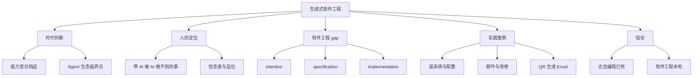

> 来源：[B站视频](https://www.bilibili.com/video/BV1pb8o6yE8f) · UP主：绿导师原谅你了 · 时长：1:40:00
>
> 本笔记由本地 GPU 转写（large-v3-turbo）和 AI 整理生成。专有名词、数字和事实性断言请结合原视频核对。

> 说明：本笔记仅依据视频信息与分块转写材料整理。转写中存在的疑似识别错误，凡影响语义判断的均放入“待核实”，正文不擅自改写为确定事实。引用保留原始时间戳。

## 一句话总结

讲者以“生成式软件工程”课程为框架，主张 AI Agent 已把“完成任务”的门槛大幅拉低，人的价值转向带着 AI 做 AI 做不到的事、补上从意图到规格到实现之间的软件工程 gap，并用大量个人实践案例论证这一判断 [07:13](https://www.bilibili.com/video/BV1pb8o6yE8f?t=433) [1:24:46](https://www.bilibili.com/video/BV1pb8o6yE8f?t=5086)。

## 视频试图回答的问题

- 在 AI 能替人出题、做作业、写代码的处境下，学生该不该学编程、该学什么 [02:25](https://www.bilibili.com/video/BV1pb8o6yE8f?t=145) [03:18](https://www.bilibili.com/video/BV1pb8o6yE8f?t=198)。
- 面对“AI 替我上大学”和“认真学完却发现 AI 都会”两种焦虑，课程能提供什么 [03:32](https://www.bilibili.com/video/BV1pb8o6yE8f?t=212) [03:50](https://www.bilibili.com/video/BV1pb8o6yE8f?t=230)。
- 生成式软件工程与经典软件工程是什么关系，AI 时代软件工程失败的定义是否改变 [07:13](https://www.bilibili.com/video/BV1pb8o6yE8f?t=433) [1:36:03](https://www.bilibili.com/video/BV1pb8o6yE8f?t=5763)。
- 保研/求职场景下，人相对于“买一个 AI 工具”的不可替代性在哪里 [1:39:06](https://www.bilibili.com/video/BV1pb8o6yE8f?t=5946)。

## 老师/讲述者提出的核心观念

**1. 计算机史的主线是把昂贵能力变成日用品。** 讲者从 PC、互联网、移动互联网讲到 2022 年 ChatGPT，用“一夜之间菜场卖菜的人都有二维码”说明生活方式的短时间改变 [00:29](https://www.bilibili.com/video/BV1pb8o6yE8f?t=29) [01:40](https://www.bilibili.com/video/BV1pb8o6yE8f?t=100) [01:57](https://www.bilibili.com/video/BV1pb8o6yE8f?t=117)。

**2. 课程定位是软件工程课，不是工具课。** 课程题目叫“生成式软件工程”，本质是一门软件工程课；软件工程做的事是“怎么样让软件工程不失败，怎么样造出一个软件” [07:13](https://www.bilibili.com/video/BV1pb8o6yE8f?t=433) [07:20](https://www.bilibili.com/video/BV1pb8o6yE8f?t=440)。

**3. 大学的价值在于信息差与“成为更好的人”。** 讲者称大学能教的重要能力之一是信息差，真正教的是怎样成为更好的人、驾驭别人驾驭不了的东西，这门课试着帮大家建立驾驭人工智能的能力 [07:48](https://www.bilibili.com/video/BV1pb8o6yE8f?t=468) [08:23](https://www.bilibili.com/video/BV1pb8o6yE8f?t=503) [08:42](https://www.bilibili.com/video/BV1pb8o6yE8f?t=522)。

**4. 课程本身以“content as code”方式生产。** 讲义先由人写好以约束 AI，F5 播放时紫色部分是模型添油加醋加上去的；markdown 是 source of truth，图片、幻灯片全部是 AIGC；课后把录像切片整理，追求“课程的数字永生” [09:37](https://www.bilibili.com/video/BV1pb8o6yE8f?t=577) [12:21](https://www.bilibili.com/video/BV1pb8o6yE8f?t=741) [13:17](https://www.bilibili.com/video/BV1pb8o6yE8f?t=797)。

**5. 对 agent 的基本定义。** 大语言模型就是一个概率分布，与概率统计课的分布没有区别，不断预测下一个 token 的概率 [20:32](https://www.bilibili.com/video/BV1pb8o6yE8f?t=1232) [20:58](https://www.bilibili.com/video/BV1pb8o6yE8f?t=1258)；agent 是语言模型输出特殊 token 调用 bash 程序，运行结果送回 loop，从而自主运行 [24:33](https://www.bilibili.com/video/BV1pb8o6yE8f?t=1473)；react 类型 agent 不停在 conversation 里改，错了试别的方法，最后完成任务 [26:47](https://www.bilibili.com/video/BV1pb8o6yE8f?t=1607)。

**6. 使用 agent 的原则。** 第一个原则是现在就开始用，第二个原则是随时问它；“你的想象力限制了你的 agent 的上限” [31:43](https://www.bilibili.com/video/BV1pb8o6yE8f?t=1903) [31:49](https://www.bilibili.com/video/BV1pb8o6yE8f?t=1909) [31:58](https://www.bilibili.com/video/BV1pb8o6yE8f?t=1918)。

**7. 学习方式发生改变。** 更多需要知道它能做什么、能做到什么程度，然后带着它去做更大的它做不到的事情；人现在唯一的功能就是带着 AI 做 AI 现在做不到的事情 [36:12](https://www.bilibili.com/video/BV1pb8o6yE8f?t=2172) [36:25](https://www.bilibili.com/video/BV1pb8o6yE8f?t=2185)。会用 agent 学习和不会用的人，效率差距是十倍一百倍 [47:06](https://www.bilibili.com/video/BV1pb8o6yE8f?t=2826)。

**8. 生态与复用的判断。** 计算机科学定律：如果一件事合理且你想做，百分之百一定有别人也想做；AI 时代复用别人的能力变得前所未有的轻松 [50:52](https://www.bilibili.com/video/BV1pb8o6yE8f?t=3052) [51:21](https://www.bilibili.com/video/BV1pb8o6yE8f?t=3081)。UNIX 哲学能成立的原因是管道，实现程序的自由组合和无限复用；AI agent 生态已达到临界点，互相组合可以成百倍成千倍放大个人能力 [1:00:21](https://www.bilibili.com/video/BV1pb8o6yE8f?t=3621) [1:01:06](https://www.bilibili.com/video/BV1pb8o6yE8f?t=3666)。

**9. 软件工程的核心是三个空间之间的 gap。** intention（意图）、specification（规格）、implementation（实现）之间存在 gap；软件工程或生成式软件工程要做的事情就是补上这些 gap [1:24:46](https://www.bilibili.com/video/BV1pb8o6yE8f?t=5086) [1:25:33](https://www.bilibili.com/video/BV1pb8o6yE8f?t=5133) [1:28:57](https://www.bilibili.com/video/BV1pb8o6yE8f?t=5337)。今天模型对这些 gap 用的是“猜”，因为后训练中模型是 reward 的 hacker，形成疯狂立即上手尽快完成任务的倾向 [1:28:57](https://www.bilibili.com/video/BV1pb8o6yE8f?t=5337) [1:29:20](https://www.bilibili.com/video/BV1pb8o6yE8f?t=5360)。

**10. AI 能完成任务，但生成的是难以维护的代码。** 讲者用 QR 生成 Excel 的受控实验说明：模型最终能完成任务，但第一反应是直接实现、陷入维护泥潭，不会先设计中间语言或好的软件架构 [1:16:00](https://www.bilibili.com/video/BV1pb8o6yE8f?t=4560) [1:20:27](https://www.bilibili.com/video/BV1pb8o6yE8f?t=4827) [1:22:24](https://www.bilibili.com/video/BV1pb8o6yE8f?t=4944)。

**11. 失败的定义没有变。** 在大语言模型时代，软件工程失败仍是从 intent 到 specification 到 implementation 的翻译错了：要么 intent 与 specification 之间不满足，要么实现不满足 specification [1:36:03](https://www.bilibili.com/video/BV1pb8o6yE8f?t=5763)。

**12. 对“品位”的判断。** 好的工程品位可以被训练出来；既然 AI 能做“做题家”，也可能拥有好的品位；讲者对此有危机感，认为课程现在教的内容可能三个月后或课程结束前就已无用 [1:37:20](https://www.bilibili.com/video/BV1pb8o6yE8f?t=5840) [1:37:24](https://www.bilibili.com/video/BV1pb8o6yE8f?t=5844) [1:37:30](https://www.bilibili.com/video/BV1pb8o6yE8f?t=5850)。

**13. 收束性判断。** 古法编程已经死了；Agent 在完成单个任务上已经无人能敌；软件工程暂时还没有死 [1:38:46](https://www.bilibili.com/video/BV1pb8o6yE8f?t=5926) [1:38:49](https://www.bilibili.com/video/BV1pb8o6yE8f?t=5929) [1:38:53](https://www.bilibili.com/video/BV1pb8o6yE8f?t=5933)。

## 概念与术语

- **Vibe Coding**：讲者称现在很厉害，操作系统作业可直接丢给 Codex 完成 [02:40](https://www.bilibili.com/video/BV1pb8o6yE8f?t=160)。
- **古法编程**：讲者要求禁止的编程方式 [15:00](https://www.bilibili.com/video/BV1pb8o6yE8f?t=900)；后文称其“已经死了” [1:38:46](https://www.bilibili.com/video/BV1pb8o6yE8f?t=5926)。
- **token maxing**：硅谷死命烧 token 的说法，讲者认为没必要 [16:04](https://www.bilibili.com/video/BV1pb8o6yE8f?t=964)。
- **make slides / subagent / 算力换智力**：从 markdown 演讲稿让 AI 添油加醋的 skill；生成三个赋予不同 personality、在隔离上下文工作的 subagent，主 agent 汇总，通过算力换智力 [10:12](https://www.bilibili.com/video/BV1pb8o6yE8f?t=612) [10:25](https://www.bilibili.com/video/BV1pb8o6yE8f?t=625) [10:49](https://www.bilibili.com/video/BV1pb8o6yE8f?t=649)。
- **content as code / everything is code / source of truth / AIGC**：一切都可以用代码生成；markdown 是源；图片、幻灯片全部由 AI 生成 [12:34](https://www.bilibili.com/video/BV1pb8o6yE8f?t=754) [13:17](https://www.bilibili.com/video/BV1pb8o6yE8f?t=797) [13:24](https://www.bilibili.com/video/BV1pb8o6yE8f?t=804)。
- **next token prediction / diffusion model**：不断预测下一个 token 的概率；从随机噪声开始一点一点生成，像人做梦一样越来越清楚，甚至不是 predict next token [21:23](https://www.bilibili.com/video/BV1pb8o6yE8f?t=1283) [27:54](https://www.bilibili.com/video/BV1pb8o6yE8f?t=1674) [28:40](https://www.bilibili.com/video/BV1pb8o6yE8f?t=1720)。
- **agents.md**：配置文件，agent 的临时记忆来源 [31:41](https://www.bilibili.com/video/BV1pb8o6yE8f?t=1901)。
- **Chrome DevTools**：专为开发者设计的接口；浏览器代码量甚至远超操作系统内核 [52:04](https://www.bilibili.com/video/BV1pb8o6yE8f?t=3124) [52:37](https://www.bilibili.com/video/BV1pb8o6yE8f?t=3157)。
- **UNIX 的 Philosophy / 飞轮**：管道实现自由组合与无限复用；信息源进入处理系统不断产生有用知识的循环 [1:00:27](https://www.bilibili.com/video/BV1pb8o6yE8f?t=3627) [1:02:29](https://www.bilibili.com/video/BV1pb8o6yE8f?t=3749)。
- **intention / specification / implementation**：意图、规格、实现三个空间 [1:24:53](https://www.bilibili.com/video/BV1pb8o6yE8f?t=5093) [1:25:38](https://www.bilibili.com/video/BV1pb8o6yE8f?t=5138) [1:26:35](https://www.bilibili.com/video/BV1pb8o6yE8f?t=5195)。
- **reward 的 hacker / reinforcement learning**：模型任务做对、测试通过就得到奖励，形成倾向；模型对真正的长程信号 reward 做得不够好 [1:29:20](https://www.bilibili.com/video/BV1pb8o6yE8f?t=5360) [1:36:34](https://www.bilibili.com/video/BV1pb8o6yE8f?t=5794)。
- **人月神话**：经典论断是团队或软件产品已开始失败时，加更多人只会让它更失败 [1:30:46](https://www.bilibili.com/video/BV1pb8o6yE8f?t=5446) [1:31:17](https://www.bilibili.com/video/BV1pb8o6yE8f?t=5477)。
- **slop**：AI 已经开始产生 slop，投入更多 token 只会让它更失败 [1:31:23](https://www.bilibili.com/video/BV1pb8o6yE8f?t=5483) [1:31:17](https://www.bilibili.com/video/BV1pb8o6yE8f?t=5477)。
- **从 bit 到 atoms**：用自然语言让 3D 打印机打印出东西，真的东西也是 code、也是 python 代码 [1:14:24](https://www.bilibili.com/video/BV1pb8o6yE8f?t=4464)。

## 关键例子和论据

**简历与焦虑。** 讲者称收到过无数份“完美简历”，对自己是零分简历，因为没有 GitHub 链接、个人主页、preprint，无法与竞争者区分 [05:28](https://www.bilibili.com/video/BV1pb8o6yE8f?t=328) [05:54](https://www.bilibili.com/video/BV1pb8o6yE8f?t=354)；所有人都是“一大堆实习、一大堆奖项、一大堆论文、一大堆在投” [06:08](https://www.bilibili.com/video/BV1pb8o6yE8f?t=368)。课程希望结束时学生简历能写“我在生成式软件工程里面实现了 ABCDE”，有很多链接 [19:29](https://www.bilibili.com/video/BV1pb8o6yE8f?t=1169)。

**用 agent 装系统。** 只用一句话让 agent 在 mirrors.nju.edu.cn 找镜像装到 U 盘、确保可启动、用模拟器验证，agent 完成安装并在 QEMU 中启动看到登录界面 [33:31](https://www.bilibili.com/video/BV1pb8o6yE8f?t=2011) [33:59](https://www.bilibili.com/video/BV1pb8o6yE8f?t=2039)；随后安装 Tile-based Window Manager，Windows+回车产生新窗口、Windows+空格挪动窗口 [34:23](https://www.bilibili.com/video/BV1pb8o6yE8f?t=2063) [34:30](https://www.bilibili.com/video/BV1pb8o6yE8f?t=2070)。终端 NeoVim 的现代配置没有看过任何一眼配置文件，全部用自然语言完成 [35:26](https://www.bilibili.com/video/BV1pb8o6yE8f?t=2126)。

**邮件与提醒。** 数据库里有历史上回过的所有邮件，收到邮件自动变已读并自动写好回复草稿，用自己口吻；简单 routine 性质的可直接用，大部分还得改 [38:01](https://www.bilibili.com/video/BV1pb8o6yE8f?t=2281)；附件如发票自动保存到指定归档位置 [38:32](https://www.bilibili.com/video/BV1pb8o6yE8f?t=2312)；在备忘录加一条“帮我把今天的发票打印出来”，点勾 commit，完成后通过 Reminder 推送到手表 [38:53](https://www.bilibili.com/video/BV1pb8o6yE8f?t=2333)。

**读论文与看视频。** 读完第一章后让模型回看人类历史中相关案例有没有 lessons、找相关工作 [42:23](https://www.bilibili.com/video/BV1pb8o6yE8f?t=2543)；读论文时假设人类已有知识都是已知的，把论文里新的东西剥离出来，12 页论文剩下很少 [43:51](https://www.bilibili.com/video/BV1pb8o6yE8f?t=2631)；给一个 BVID，把 podcast 总结成自动的图文时间轴，两帧图片间隔大到一定程度就截图，得到视频的 ground truth [45:18](https://www.bilibili.com/video/BV1pb8o6yE8f?t=2718) [46:27](https://www.bilibili.com/video/BV1pb8o6yE8f?t=2787)。

**直播事故。** 直播时 USB 摄像头卡了，采集卡 USB 断开，立即让 agent 修，用前所未见的 Linux 命令以软件方式把 USB 采集卡拔出又插入，然后就好了 [48:35](https://www.bilibili.com/video/BV1pb8o6yE8f?t=2915)。

**教务系统填表。** 讲者称讨厌教育系统，讲到软件工程时会讲教务系统是软件工程非常反面的例子 [55:01](https://www.bilibili.com/video/BV1pb8o6yE8f?t=3301)；让 AI 填写教学周历，模型不听指令是 DeepSeek V4 Flash 的问题，用最一线模型会遵循得更好 [56:33](https://www.bilibili.com/video/BV1pb8o6yE8f?t=3393) [57:23](https://www.bilibili.com/video/BV1pb8o6yE8f?t=3443)；走通过一次后 session 里的东西会留下来，可以沉淀成确定性脚本、形成记忆，得到自动选课抢课系统 [59:24](https://www.bilibili.com/video/BV1pb8o6yE8f?t=3564)。

**改卷统分流水线。** 顶向下摄像头拍试卷固定位置，按回车拍照，offline 识别姓名、学号、小分，每个小分写一行到文本文件 [1:06:41](https://www.bilibili.com/video/BV1pb8o6yE8f?t=4001)；第二阶段按反序，左手按回车右手拿笔，用语音播报并检查，因为 OCR 会有错，要对班上每个同学负责 [1:07:16](https://www.bilibili.com/video/BV1pb8o6yE8f?t=4036)；最终分数由脚本算出并抄写到卷面，没有让大模型做加法，每个分数都看过 [1:07:52](https://www.bilibili.com/video/BV1pb8o6yE8f?t=4072)。

**二维码偷数据（QR 生成 Excel）。** 设想在数据可进不可出的受控机器里，把文件内容编码成二维码动画，按住 F9 刷新循环播放，偷偷射屏拍下每一帧就把数据偷走 [1:09:40](https://www.bilibili.com/video/BV1pb8o6yE8f?t=4180) [1:11:20](https://www.bilibili.com/video/BV1pb8o6yE8f?t=4280)；用的全部是 Excel 公式，且是 2019 之前 Excel 都兼容的公式 [1:12:01](https://www.bilibili.com/video/BV1pb8o6yE8f?t=4321) [1:12:24](https://www.bilibili.com/video/BV1pb8o6yE8f?t=4344)；这个 Excel 是用 AI 生成的，“想象力限制了你能做什么” [1:13:30](https://www.bilibili.com/video/BV1pb8o6yE8f?t=4410)。

**QR 生成实验的对比。** 直接让 AI 做时，GPT5.6 依然误解了要什么东西，第一秒钟就被带歪了 [1:18:07](https://www.bilibili.com/video/BV1pb8o6yE8f?t=4687) [1:18:15](https://www.bilibili.com/video/BV1pb8o6yE8f?t=4695)；软件工程的第一步是不要扩大、做最简单的东西、不会失败，它没有理解这一点 [1:18:39](https://www.bilibili.com/video/BV1pb8o6yE8f?t=4719)。受控实验中，AI 5.3 第一次思考了 25 分钟，写了超过 32k 的 output token，总共跑了六个小时才跑完，但是对的 [1:19:00](https://www.bilibili.com/video/BV1pb8o6yE8f?t=4740)；Deepseek V4 Pro 晚上放着跑，第二天早上给了硬编码的 base64，明显不符合指令 [1:19:33](https://www.bilibili.com/video/BV1pb8o6yE8f?t=4773)。讲者的做法是先让 AI 设计一个既对 Python 友好也对 Excel 友好的中间语言，分别验证翻译正确性，最后一把头生成就直接正确，代码非常干净 [1:22:24](https://www.bilibili.com/video/BV1pb8o6yE8f?t=4944)。但两份代码要把工作区从一个位置移动到另一个位置，都得修两个小时，因为所有东西都是硬编码 [1:23:51](https://www.bilibili.com/video/BV1pb8o6yE8f?t=5031)。

**三个空间的梗图。** 讲者引用软件工程很早的梗图说明 gap：客户这样解释需求，project leader 这样理解，分析的人这样想，宣传的人这样宣传，最后 customer 要的是这个，造出来的是那个 [1:28:05](https://www.bilibili.com/video/BV1pb8o6yE8f?t=5285)。

**教育体系的判断。** 讲者称现今教育体系的一个很大问题是所有考试题都是分钟级能点别的，人五分钟解决不了题一般就不会出了，长久以往训练的就是五分钟解决，和 agent 训练的 reward 一样，agent 有更多数据、更明确的反馈信号所以做得比你好 [1:34:36](https://www.bilibili.com/video/BV1pb8o6yE8f?t=5676) [1:34:45](https://www.bilibili.com/video/BV1pb8o6yE8f?t=5685)。

**保研问题的回答。** 课程试图回答：保研时导师问“为什么我要招你，而不是买一个 200 刀的 Cloud Max”，怎么接这个问题 [1:39:06](https://www.bilibili.com/video/BV1pb8o6yE8f?t=5946)；讲者认为 GPT5.6 在这个问题上回答得还挺好，虽然它做不到，其回答大意是能找到值得解决的问题、把未知拆成便宜的实验、用证据让坏方向及时停下、并对长期结果负责 [1:39:19](https://www.bilibili.com/video/BV1pb8o6yE8f?t=5959) [1:39:25](https://www.bilibili.com/video/BV1pb8o6yE8f?t=5965)。

## 思维导图

> 待作者补充。
